# 基于飞行品质模型的飞控大模型研究

> 论文整合修订版 · 2026-10-25 · 纳入 GJB 原文核查、对象库覆盖审计及数学说明；本次未新增策略训练

## 摘要

本文研究飞控控制器的构建路线：按飞行品质相关参数组织源域对象、训练专用教师、蒸馏统一学生并进行目标域适配。现阶段以滚转通道开展路线可行性验证。归档主线构造 5,000 个参数化对象，报告 49 个 PPO 教师中 46 个通过项目门限，及 tiny（3,856 参数）和 small（75,040 参数）两种学生。tiny 相对教师的 RMSE 中位倍数为同分布 1.28、四对象留出 1.68；small 为 1.34、1.41。上述结果存在精度损失，不能证明容量无关或把差距归因于特权信息。300 个同分布对象的 ±1/±31 deg/s 通过率为 99.7%/60.3%，500 个 OOD 对象为 86.8%/27.6%。DHC-6 仿真辨识对象上的 small 适配组中位误差由 2.913 降至 0.595 deg/s，留出组由 2.662 降至 2.148 deg/s；这些主线数值保留为归档报告值，完整原始证据未随包提供。

2026-10-24 的路线验证在训练前固定 12 个源对象、24 个 ID 留出对象、24 个 OOD 对象及三个策略种子，实际训练 36 个教师与三个统一学生。8 s 独立指令测试中，教师源对象通过率为 61.1%–82.4%，学生为 48.1%–87.0%；学生 ID 为 40.7%–68.1%，OOD 为 38.9%–51.4%。同源蒸馏在一个种子下降约 13 个百分点，30 s 测试出现六次学生发散，因此不能概括为可靠无损或长时稳定。等目标预算的 DHC-6 ARX 对照中，三个种子预训练后适配的留出通过率为 75.0%/75.0%/80.6%，从零为 58.3%/63.9%/61.1%，支持当前辨识仿真和配方下的预训练收益。详见第 6.5 节。

此前修订核对并重建了 510 对象的 SAE 数据，修复学生参考对真实时延的依赖、跨时延更新中的样本回流，以及探针和频响评价的时间问题。在严格 1.2 s 截止下，互相关时延探针 R²=0.984、MAE=5.6 ms。对归档频响修正 20 ms 时间偏差并重新拟合后，raw/SAE-aux 的可评对象分别为 73/101 个，中位等效延迟为 0.093/0.125 s，Top-k 为 0/120 可评。另补固定公共参考对照和两种策略种子的训练范围受限实验。结论限定于所述仿真对象、输入条件与项目门限，不等同于实飞验证或 GJB 符合性评价。

补充的对象库审计发现，4,500 个非 OOD 对象仅覆盖 8 种已实现判据的等级组合，全库不存在两项及以上已分级指标同时退化的对象。0.75 s 建库记录不足以支持旧辅助振荡比和调节时间的品质解释。本文据此限定源域覆盖与指标适用范围，并提供覆盖 54 种分量等级组合和 14 组活动阈值边界的 190 对象构造样例；该样例仅完成构造与数值验证，尚未用于控制器训练。数学方法在第 2—3 节展开，代数算例见附录 A。

**关键词：** 飞行品质；低阶等效系统；强化学习；教师—学生蒸馏；交互式模仿；迁移学习

## 1 引言

“品模”项目以飞控控制器为研究核心，探索跨对象共享策略的构建与适配路线。滚转角速度内回路是现阶段的可行性验证任务，DHC-6 仿真辨识对象用于检验目标域适配。指令跟踪、指令引起的振荡以及扰动或初始偏差引起的振荡属于该验证任务的评价内容。全通道、耦合和实机验证是后续扩展；当前重点是教师、蒸馏学生及新对象适配各环节的结果是否可靠。教师约 4.26 M 参数，源域 tiny 学生为 3,856 参数；文中较好的目标域适配数字属于 75,040 参数 small，不能合并成同一规模模型的成绩。

流程包括品质相关参数分层采样、逐对象教师、统一学生蒸馏和目标域微调。飞行品质标准指导对象构造及部分事后评价；RMSE、峰值误差、操纵总变差率的准入门限由项目另行定义。归档奖励由跟踪误差、作用力能量与力速率动作幅值组成，尚未直接优化全部 GJB 条款，也未证明品质分层优于相同预算的一般参数采样。

本修订版区分三类证据：第 3—5 节主线的归档报告值；第 6.1 节可由随包数据或重建数据核对的结果；第 6.2 节新增的受控对照。第 6.4 节另列品模与 PPO 实现深查，发现并修复一秒灵敏度时间偏移、动作概率不一致及回合末值语义问题；其小规模训练仅验证实现流程。归档教师、六轮蒸馏、幅值扫描及 small 迁移的完整记录缺失，不能把同名旧实验摘要当作本版原始证据。第 6.5 节列出 controller-route-v1 的独立三种子实验，第 6.6 节是 2026-10-25 并入论文的对象库审计，不包含新策略训练。版本对应关系见修订说明。

### 1.1 相关工作

飞行品质与学习控制。飞行品质规范及低阶等效系统为对象参数化和响应评价提供依据^{[1,2,13]}。Jansen 与 van Kampen 研究 SAC 飞控的纵向操纵品质评价^{[16]}，是强化学习与航空品质评价的直接相关工作；本次仅核到其摘要、首页与部分引言，不引申未读到的实验细节。Bøhn 等在固定翼姿态控制中研究 SAC 的仿真到实飞迁移，强调延迟与动力学随机化^{[17]}。本项目当前验证范围为滚转参数化对象和 DHC-6 仿真辨识对象。

特权信息与蒸馏。LUPI 与广义蒸馏允许教师、学生拥有不同信息^{[5,18]}；这与单纯缩小网络容量是两个变量。Asymmetric actor–critic 让 critic 使用完整状态、actor 使用部署观测^{[6]}，并不必然需要两阶段教师—学生蒸馏。足式机器人特权学习、RMA 以及航空 Extreme Adaptation 展示了利用历史或潜变量进行动力学适应的路线^{[7–9,15]}，但“信息能够读出”仍不能替代闭环收益的验证。

通用飞控策略。RAPTOR 通过 1,000 个专用 RL 教师训练统一的 2,084 参数循环学生，并在多个真实四旋翼上验证^{[14]}，与本项目多教师到小型通用策略的链路最接近。其相关工作进一步连接 Extreme Adaptation、One Net to Rule Them All、Learning by Cheating、RMA、A-NC 和 DAgger。比较时需要对齐控制层级、动力学覆盖、部署输入和实机证据。竞速飞行^{[11]}、Neural-Fly 抗风适应^{[10]}和 Learning to Fly in Seconds^{[12]}分别提供不同任务和训练范式的参照，不能概括成所有工作都只面向单一平台。

多教师与多轮更新。Policy Distillation 研究将策略知识转移到统一学生^{[19]}；DAgger 在学生访问状态上追加专家标签^{[4]}。Distilling Policy Distillation 强调采样分布和更新目标的区别^{[20]}。反复采集、网络训练 epoch、多代学生成为教师以及多教师合并是不同概念；Born Again Networks 和 Teacher Assistant KD 分别提供多代与分级蒸馏参照^{[21,22]}，不能据此推定飞控品质随轮数单调改善。RAPTOR 的当前策略采样变体也不应直接写成原始 DAgger 的完整历史数据聚合。

本文考察“品质相关对象族→专用教师→统一学生→新对象适配”的飞控控制器构建路线，在滚转任务中检验其可行性和失效边界。当前需要核验教师学习、学生能力保留及新对象泛化与适配的连续证据。品质分层采样的独立收益和特权信息作用还需受控比较；真实固定翼跨机型部署属于后续验证范围。

关于对象的物理解释，Davidson 与 Andrisani 将特征向量与滚转、侧滑响应的传递函数联系起来^{[24]}，说明仅给定模态阻尼和频率仍不足以确定输出中的振荡幅度。Morelli 的 LOES 辨识以驾驶操纵为输入、飞机响应为输出，模型包含机体与控制系统总效应^{[25]}。因此本研究使用参数化对象时必须声明控制边界；教师与学生接入后形成的新闭环，需要按自己的输入输出重新评价。

## 2 问题定义与控制对象

### 2.1 控制任务与接口变量

被控量为滚转角速度 p，外部任务给定指令 p_cmd。归档训练环境以二阶参考模型和对象真实时延 τp 生成 p_ref；因此该参考不是仅由指令决定。修订代码默认采用不读取对象参数的公共参考，旧实验通过 legacy_plant 模式显式保留。PPO 策略使用 p_ref 及其他闭环量构成观测，并以 e_t = p_ref,t − p_t 计算跟踪误差。

$$ P_{\mathrm{ref}}(s)=\frac{\omega_n^2 e^{-\tau_{\mathrm{ref}}s}}{s^2+2\zeta_n\omega_ns+\omega_n^2}P_{\mathrm{cmd}}(s),\quad \omega_n=2\,\mathrm{rad/s},\quad\zeta_n=0.7 \tag{1} $$

归档模式取 τ_ref=τp，需要真实对象参数；修订公共参考取 τ_ref=0，并从参考模型当前状态计算导数。两种模式不是同一输入条件，归档性能不能自动重命名为公共参考结果。第 6.2.1 节对同一冻结权重作了配对检查。

策略输出为归一化力速率动作 a_t，而不是副翼偏角。动作经力速率约束和请求力积分后形成作用于滚转对象的输入；目标域接口再将请求力映射为副翼偏角。因此，本文评估的是带有既定接口和执行机构的滚转控制器回路。

观测按三段拼接，维数可以直接核对：当前量 9 项、历史 32 步、动作 7 步。当前量依次为指令 p_cmd、参考响应 p_ref、实际响应 p、误差 e = p_ref − p、误差积分 ∫e dt、角速度导数 ṗ、参考导数 ṗ_ref、请求力 F_req 与施加力 F_applied；历史段是过去 32 步的同构 5 通道（p_cmd, p_ref, p, e, F_req），共 160 维；动作段是最近 7 步的归一化动作。三段合计 9 + 160 + 7 = 176 维。

$$ \begin{gathered}o_k=\operatorname{Norm}([o_k^{\mathrm{cur}},h_k,a_{k-7:k-1}])\in\mathbb R^{176},\\o_k^{\mathrm{cur}}=[p_{\mathrm{cmd}},p_{\mathrm{ref}},p,e,\int e\,dt,\dot p,\dot p_{\mathrm{ref}},F_{\mathrm{req}},F_{\mathrm{applied}}],\\o_k^T=[o_k,z_k]\in\mathbb R^{188},\qquad o_k^S=o_k.\end{gathered} \tag{2} $$

归一化尺度：指令、参考、响应、误差取 30 deg/s；力取 22 N；角加速度取 5 rad/s²（约 286.5 deg/s²，与代码常数一致）；误差积分取 30 deg/s·s。h 为 32×5 历史块，a 为 7 维动作块。

教师另接收 12 维特权量 z_t（8 个对象参数与 4 个对象内部状态），构成 188 维输入；学生不直接接收 z_t，但归档 176 维输入中的参考仍依赖 τp。因此只能称去掉显式特权向量，不能称全链路无对象参数。公共参考修订消除了这条依赖；传感器估计、执行机构内部量的获得方式仍需在实际部署接口中定义。

本文区分对象参数 θ 与控制器权重 w：前者决定仿真对象的动态，后者决定根据观测采取什么动作。教师训练中，单个专用教师对应的 θ 固定，优化器更新 w；统一学生随后学习多个教师的行为。p 是机体系滚转角速度，φ 是倾斜角；仅在简化纯滚转条件下可用 φ̇≈p，不能在一般耦合运动中直接等同。

| 符号 | 含义与单位 | 数学作用 |
|---|---|---|
| p、p_ref、e | 实际、参考滚转角速度及其误差；rad/s，报告时换算为 deg/s | e=p_ref−p |
| F_req、F_applied | 请求力、执行机构施加力；N | 有限幅、限速和滞后，不能互换 |
| u、a | 原始高斯采样、环境裁剪后的动作；无量纲 | a=clip(u,−1,1)，PPO 密度比使用 u |
| x | 四维传递函数实现状态 | 不直接等于真实 p、r、β、φ |
| o、z、ξ | 普通观测、Actor 特权向量、Critic 输入 | ξ 还可包含延迟队列和回合进度 |
| θ、w、v | 对象参数、Actor/学生权重、Critic 权重 | 物理参数与可训练参数分别定义 |
| s、k、j | 拉普拉斯变量、20 ms 控制步、1 ms 对象步 | s 不是时刻；k、j 是离散编号 |
| γ、λ、λ_s | 回报折扣、GAE 权重、螺旋特征根 | 前两者属于训练；λ_s 属于对象动态 |

上点表示时间变化率，积分表示随时间累积，平方表示该量与自身相乘，Σ 表示求和，E 表示对采样分布取期望。这些运算在附录 A 中用具体数值展开。

### 2.2 参数化滚转对象

源域以参数化低阶等效模型描述滚转角速度对输入力的响应。模型包含滚转模态、螺旋模态、荷兰滚模态及输入时延，其传递函数写为：

$$ G_\theta(s)=\frac{L_{Fa}s(s^2+2\zeta_\phi\omega_\phi s+\omega_\phi^2)}{(s-\lambda_s)(s+1/T_R)(s^2+2\zeta_d\omega_ds+\omega_d^2)}e^{-\tau_ps} \tag{3} $$

参数向量为 θ = (L_Fa, λ_s, T_R, ζ_d, ω_d, R_ω, R_ζ, τ_p)。其中，L_Fa 为滚转控制效能，λ_s 与 T_R 描述螺旋和滚转模态，ζ_d、ω_d 为振荡模态阻尼比与自然频率；R_ω、R_ζ 定义零点相对模态的频率和阻尼，τ_p 为输入时延。本文通过采样 θ 构造源域对象族；该对象族用于覆盖研究设定，不视为真实机队参数的概率模型。

代码采用 ω_φ=R_ωω_d、ζ_φ=R_ζζ_d。式 (3) 是零初始状态下输入力与输出角速度在拉普拉斯域的关系；非零初始条件还会贡献自由响应。其不含纯延迟的有理部分转换为四维状态空间，再按零阶保持离散化：

$$ x_{j+1}=A_d x_j+B_d F^{\mathrm{delayed}}_j,\qquad p_j=Cx_j,\qquad \Delta t_{\mathrm{plant}}=0.001\,\mathrm{s}. \tag{3a} $$

矩阵乘法表示状态之间以及输入到状态的线性组合；延迟队列、执行机构和等效输入扰动由环境另外推进。每个控制步包含 20 个对象步。当前初始滚转偏差按 Cx=p₀ 的最小范数实现状态设置，不能解释成真实飞机其余物理状态都为零。

单个滚转模态含 exp(−t/T_R)，欠阻尼荷兰滚模态可写为 exp(−ζ_dω_dt) 乘正弦或余弦。后者包络由 ζω 乘积决定，实际振荡角频率为 ω_d√(1−ζ_d²)。分子零点和模态系数决定这些分量在 p 上出现多强；因此“阻尼较好”与“整段滚转响应无明显振荡”并非同一个判定。全部参数组合能否嵌入真实飞机的物理模型尚未证明。

GJB 原文使用的驾驶杆力 F_as→p 与本实验的速率指令 p_cmd→闭环 p 是不同映射。若未来从实际驾驶操纵记录辨识对象，其 LOES 可能已包含原飞控和执行机构，新增控制环之前必须核清边界^{[25]}。目前等效 N 输入及另加执行机构属于研究接口约定。

完整扫描件的印刷 211 页与 212 页模态响应支持式 (3) 的单个原点零点，而印刷 236 页另印出分子 s²，延迟项排印也有差异，见[原文公式对照一](evidence/gjb_audit/pages/formula_215.png)和[对照二](evidence/gjb_audit/pages/formula_240.png)。本研究保留 single-s、负指数因果延迟的建模选择，并以 NASA-TM-110306 式 (2.15) 交叉核对^{[24]}；不将此选择写成官方勘误，也不再声称扫描页各处公式完全一致。

### 2.3 评价指标与判定门限

飞行品质标准用于界定模型参数与评价背景^{[1,2]}；本文的量化门限用于该回路的验收。闭环性能按参考跟踪 RMSE、峰值误差和请求力总变差率评价，教师验收门限分别为 1.5 deg/s、5 deg/s 和 12 N/s。

$$ \begin{gathered}\mathrm{RMSE}_p=\sqrt{\frac1M\sum_{k=1}^{M}(p_{\mathrm{ref},k}-p_k)^2},\quad\mathrm{Peak}=\max_k|p_{\mathrm{ref},k}-p_k|,\\\mathrm{TV}_F=\frac1{T}\sum_{k=1}^{M}|F_{\mathrm{req},k}-F_{\mathrm{req},k-1}|.\end{gathered} \tag{4} $$

M 为评价时域内采样点数，T 为评价时长。误差在仿真中按 rad/s 计算、报告时换算为 deg/s；TV_F 表示请求力总变差率，单位为 N/s。

## 3 方法：四步构建与迁移

图 1 概括本文的离线训练链路。四步各自的产物与证据一并画在图上：对象族的参数分布、49 个教师的通过情况、学生网络与接口，以及目标域适配前后的误差。前两步在飞行品质参数化对象上构造并训练教师，第三步将多对象教师压缩为共享学生，第四步以目标域仿真模型更新学生参数。四步使用不同对象集和监督信号，后续各节分别给出定义。

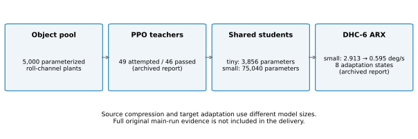

*图 1　研究流程及证据边界。源域 tiny 与目标域 small 分别标出；49/46 教师和 small 迁移数值为原稿报告值，本包缺少其完整原始记录。*

### 3.1 第一步：随机采样飞行品质模型

在第 2.2 节定义的八维参数空间内生成 5,000 个滚转对象。采样按飞行品质等级和数据用途进行分层：4,500 个对象属于训练及同分布评估池，另 500 个构成分布外评估集。生成对象后依据参数和对应判据标注等级；该步骤构造的是受约束的实验对象库，并不估计真实机队中各参数的发生概率。

$$ \theta^{(i)}\sim q(\theta\mid c_i),\qquad g_i=\operatorname{Grade}_{\mathrm{partial,IV,A}}(\theta^{(i)},c_i) \tag{5} $$

其中，θ^{(i)} 为第 i 个对象的参数向量，c_i 为其分层类别，q 表示满足既定覆盖配额的采样分布。g_i 仅表示当前 IV 类、A 阶段、非 CO/GA、杆式操纵假设下，滚转时间常数、螺旋倍幅时间、荷兰滚基础门限和一秒灵敏度四项的分层标签。A116、A35 的 φ/β 条件修正、闭环等效延迟及跨轴品质未完整纳入，不是完整飞行品质等级。

train_boundary 与 train_core 从同一等级池依次分配，当前未按边界距离选点；OOD 还混合了品质门限、效能、零点比率和时延范围之外的对象。复算显示 5,000 个历史标签均与历史实现规则一致，但修复一秒灵敏度的 1 ms 时间偏移后，两个对象跨越标签边界。原库及训练划分保留，详见第 6.4 节。v2 的灵敏度修正版本与第 6.6 节的新联合构造样例分别标识；不得将不同版本的标签、分布或成绩混合。

#### 3.1.1 标准边界与部分标签

GJB 2874—97 附录 A 是编制依据和建议值，提供品质边界参考，不规定随机采样分布。本研究采用 IV 类、A 阶段、非 CO/GA、杆式操纵的源域假设；不能将该分类自动套用于 DHC-6 或所有目标飞机。下表列出实际采用的单项筛选及缺失条件；页码为原文印刷页，PDF 页码需加 4。

| 单项 | 一级 / 二级 / 三级基准 | 原文及适用范围 |
|---|---|---|
| 滚转时间常数 T_R | 上限 1.0 / 1.4 / 10 s | [A18，211 页](evidence/gjb_audit/pages/pdf_215.png) |
| 螺旋倍幅时间 | 下限 12 / 8 / 4 s；λ_s>0 时为 ln(2)/λ_s | [A19，225 页](evidence/gjb_audit/pages/pdf_229.png)；允许部分慢发散螺旋模态 |
| 一秒倾斜角灵敏度 | 上限 3.38 / 5.62 deg/N；未给三级上限 | [A31，272 页](evidence/gjb_audit/pages/pdf_276.png)；用一秒速率积分标定 L_Fa |
| 荷兰滚基准 ζ_d、ζ_dω_d、ω_d | 一级 ≥0.19、0.35、1；二级 ≥0.02、0.05、0.4；三级 ζ_d≥0、ω_d≥0.4 | [A35，298–299 页](evidence/gjb_audit/pages/pdf_302.png)；[φ/β 修正条件](evidence/gjb_audit/pages/pdf_303.png)尚无法由本 SISO 检查 |

A35 在 ω_d²|φ/β|_d>20 时还调整阻尼频率乘积要求，故本文只使用基准门限。A20 的 A 阶段各等级均不允许滚转—螺旋耦合模态；旧清单曾把 B/C 数值混入 A，已在[复核清单](evidence/gjb_audit/quality_parameter_registry_reviewed.csv)中纠正。A21 的 0.10/0.20/0.25 s 是总响应的等效延迟建议值，不能直接作为运输延迟 τ_p 的同义量。滚转振荡还涉及峰谷定义、螺旋分量处理、侧滑相位及操纵条件，未被式 (5) 的四项标签完整覆盖。

#### 3.1.2 联合覆盖和边界的构造定义

以四个分量标签 (g_TR,g_spiral,g_Dutch,g_S) 建立 3×3×3×2=54 格诊断网格。该网格检查采样是否遗漏联合退化，既不表示真实机队应均匀分布，也不保证每格都对应可实现的飞机。已知困难对象不因原始品质较差而自动删除；应另行记录控制权限和任务可达性。

新构造样例在每个格内随机取参数，并对正阈值 b 构造成对 θ⁻、θ⁺，令目标指标分别位于 0.98b 和 1.02b，同时检查该阈值在其余条件下确实引起分级变化。训练、验证和 ID 测试使用不同参数向量。荷兰滚二级覆盖频率不足、阻尼不足和乘积不足的分支，运输延迟研究范围覆盖至 0.25 s。真实覆盖计数与尚未完成的步骤见第 6.6 节。

### 3.2 第二步：逐对象训练强化学习教师

归档主线报告为 49 个源域对象分别训练 PPO 教师^{[3]}；第 6.5 节可追溯的新协议实际训练 12 个对象×3 个种子的 36 个教师。Actor 根据式 (2) 的观测和对象特权量输出高斯分布，训练采样 u_t，物理动作取 a_t=clip(u_t,−1,1)。修订实现将未裁剪 u_t 存入 PPO buffer；确定性评价执行策略均值并经过相同环境限幅。在 50 Hz 策略周期下，每个动作将请求力改变至多 1.76 N；请求力被限制在 ±22 N。随后，1 kHz 环境中的命令力以 88 N/s 速率跟随请求力，施加力再经时间常数为 20 ms 的一阶执行机构模型作用于对象。

$$ \begin{gathered}F_{\mathrm{req},k+1}=\operatorname{clip}(F_{\mathrm{req},k}+(88\,\mathrm{N/s})a_k\Delta t,-22\,\mathrm N,22\,\mathrm N),\\\Delta t=0.02\,\mathrm s.\end{gathered} \tag{6} $$

±22 N 是该 PPO 环境定义的动作接口范围与力归一化尺度，不是 PPO 算法自带的常数。它为当前训练对象规定了有界的请求力范围，并与奖励中的力归一化以及后续副翼桥接保持一致；复现或比较现有策略时应保留。迁移接口将其按 δ_a = −(10°/22 N)F 映射为 ±10° 副翼请求；88 N/s 的速率边界在同一桥接下对应 40°/s。因此 22 N 与 88 N/s 是虚拟力域对舵面位置和速率范围的表示，不是 DHC-6 实测的机械参数。面向实际控制器时，应由目标执行机构经验证的位置与速率限制取代这一配置假设。

策略网络以一维卷积编码时序历史，并由残差主干生成动作分布；均值头采用无偏置线性层和奇对称投影；投影本身保证有符号输入全零时均值为零，无偏置头是额外结构选择。表 1 汇总教师结构与训练配置。

#### 3.2.1 即时奖励函数

归档 PPO 实验采用由跟踪误差、作用力能量和动作幅值组成的即时奖励。观测误差为 p_ref,t−p_t。归档代码在一个控制周期积分后，以当前区间参考与下一时刻输出计算奖励，记 e_{t+1|t}=p_ref,t−p_{t+1}；归一化尺度为 30 deg/s：

$$ r_k=-50\left[\left(\frac{e_{k+1\mid k}}{p_{\mathrm{scale}}}\right)^2\Delta t+0.02\left(\frac{F_{\mathrm{applied},k+1}}{22\,\mathrm N}\right)^2\Delta t+0.02a_k^2\right] \tag{7} $$

第一项惩罚归一化跟踪误差，第二项惩罚归一化作用力能量，第三项惩罚力速率动作本身的幅值；第三项不是相邻时刻动作之差。式中 p_scale = 30 deg/s。

第 6.5 节使用同一时刻的参考与响应 e_{k+1}=p_ref,k+1−p_k+1，消除旧区间口径错位。代入 Δt=0.02 s 后，该协议的一步奖励化简为：

$$ r_k=-\left[\left(\frac{e_{k+1}}{30\,\mathrm{deg/s}}\right)^2+0.02\left(\frac{F^{\mathrm{applied}}_{k+1}}{22\,\mathrm N}\right)^2+a_k^2\right]. \tag{7a} $$

各项归一化后无量纲。正负误差均受到惩罚，误差幅值加倍会使该项代价变为四倍。原式动作项未再乘 Δt，最终系数为 1；不能仅从某行的 0.02 判断动作惩罚很弱。a=0 表示保持请求力，施加力仍可能非零。饱和时 a 的代价也不等于实际请求力变化代价。

教师优化的是有限轨迹上的期望折扣回报，而非逐步贪心地只减小当前代价：

$$ G_k=\sum_{\ell=0}^{H-1-k}\gamma^\ell r_{k+\ell},\qquad J(w)=\mathbb E_{\tau\sim\pi_w}[G_0],\qquad H=400. \tag{7b} $$

E 对随机动作、指令及初始化等引起的轨迹分布取期望。γ=0.995 在 50 Hz 下对一秒跨度的权重约为 0.778，对八秒跨度约为 0.135；当前任务在 8 s 结束。误差、力和动作的权衡及折扣范围必须与恢复任务共同审查，不能仅凭奖励上升宣称抑振达标。

#### 3.2.2 PPO 优化目标

优势估计采用广义优势估计（GAE）^{[23]}。Critic 输入记为 ξ，以避免与拉普拉斯变量 s 或四维对象实现状态 x 混淆；其中可包含普通观测、对象状态、延迟队列及回合进度。V_v(ξ) 估计未来折扣回报，δ 衡量一步反馈相对旧预测的差异，Â 汇集多个这样的差异。时序差分残差和优势递推为：

$$ \begin{gathered}\delta_k=r_k+\gamma(1-d_k)V_v(\xi_{k+1})-V_v(\xi_k),\\\widehat A_k=\delta_k+\gamma\lambda(1-d_k)\widehat A_{k+1},\quad\gamma=0.995,\quad\lambda=0.95.\end{gathered} \tag{8} $$

当前修订默认将 8 s 定义为有限时域任务，末步 d_t=1，bootstrap=0；完整 rollout 内没有中途重置，故代码仅需处理末值。归档训练器从自动重置状态取末值，现保留为显式 legacy_reset 目标，不能称为标准时间截断处理。若采用持续任务截断，需从重置前末状态估值。GAE 与 PPO 本身不提供闭环稳定性或飞行品质保证。

λ=0.95 调节优势估计的偏差与方差，不是飞机阻尼；Critic 训练后不承担部署控制。正优势意味着该样本的后果优于估计基准，并不要求 r 本身为正。

令 ρ_t(w)=π_w(u_t|o_t,z_t)/π_old(u_t|o_t,z_t)，分子分母必须针对同一未裁剪高斯样本。原随包实现曾混用 u_t 与 clip(u_t)，已修复；不能据此追认缺少代码版本记录的旧教师。剪切代理损失定义为：

$$ L_{\mathrm{clip}}(w)=-\mathbb E_k\left[\min\left(\rho_k\widehat A_k,\operatorname{clip}(\rho_k,1-\varepsilon,1+\varepsilon)\widehat A_k\right)\right],\quad\varepsilon=0.2 \tag{9} $$

Actor 与 Critic 采用剪切策略损失、价值函数误差和熵正则项联合优化：

$$ \begin{gathered}L_{\mathrm{total}}=L_{\mathrm{clip}}+0.5\mathbb E[(V_v(\xi_k)-R_k)^2]-0.001\mathcal H(\pi_w),\\R_k=\widehat A_k+V_{\mathrm{old}}(\xi_k).\end{gathered} \tag{10} $$

原稿报告每个对象训练 30 轮，每轮由 512 个并行环境各运行 400 个策略步，累计约 614 万个状态转移；第 6.5 节另以 12 对象×3 种子执行同等单教师预算，不替代原 49 教师记录。Actor 与 Critic 使用 Adam，学习率为 3×10^{−4}。

ρ 是同一连续动作在新旧策略下的概率密度比；clip 作用于代理目标的该比值，不是把物理动作改变限制为 20%，也不强制所有比值永远处于 [0.8,1.2]。对正优势样本，增加其密度能改善目标，但超过裁剪端后不再获得同样的收益。策略梯度与价值损失用于调整网络权重，控制周期内的动作计算只执行网络前向。第 6.5 节每批最多更新 5 遍、小批次 16,384，近似 KL 超过 0.03 时停止本批更新；梯度范数上限 0.5 与执行机构的 88 N/s 限速是不同约束。

#### 3.2.3 奖励与品质维度的对应

奖励三项是响应跟踪、操纵能量和力速率幅值的代理代价；没有建立它们与 GJB 条款逐项等价的关系。品质相关参数用于源域对象构造，训练后用项目定义的 RMSE、Peak、TV 门限准入。LOES 等效延迟另作事后分析，不等同于直接以 GJB 品质指标训练。

表 1　教师网络与训练设置

| 项 | 设置 |
| --- | --- |
| 输入 | 常规输入 176（归档参考含 τp）+ 显式特权信息 12 |
| 时序前端 | 3 层一维卷积，dilation 1/4/8，感受野 27 步 |
| 主干 | 残差 MLP 512 × 8，pre-LN、SiLU、无偏置均值头、奇对称投影 |
| 输出 | 归一化增量动作 ±1 → 请求力每步变化至多 ±1.76 N；请求力限幅 ±22 N |
| 算法 | PPO，614 万步/架，γ 0.995，λ 0.95，clip 0.2 |
| 规模 | 4.26 M 参数，单卡约 9.5 min/架 |

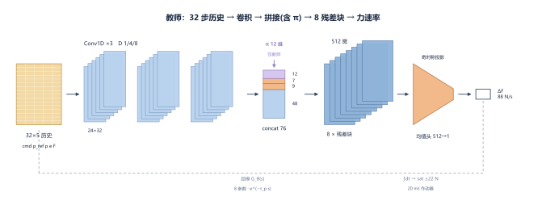

*图 2　教师策略的张量形状：32×5 历史窗口 → 三层 24 通道卷积 → 76 维拼接（48 卷积 + 9 当前 + 7 旧动作 + 12 特权）→ 8 个残差块（512 宽）→ 均值头输出力速率；虚线为品模闭环回路。*

### 3.3 第三步：DAgger 蒸馏统一学生

源域学生以多对象教师提供的状态—动作样本进行监督学习。初始数据由教师策略访问闭环状态并标注动作；后续 DAgger 轮次由学生策略访问状态，再由对应教师为这些状态补充动作标签^{[4]}。原稿记录经过六轮数据聚合后，分别训练 3,856 参数 tiny 学生和 75,040 参数 small 学生。学生保留时序特征结构，不直接使用 12 维教师特权输入；归档参考信号的参数依赖见第 2.1 节。六轮主线的逐轮数据与权重未随包完整提供，以下定义说明原稿方法，不构成本次独立复现。

$$ \begin{gathered}\mathcal D_0=\{(o_k,\mu_T(o_k,z_k))\},\\\mathcal D_{m+1}=\mathcal D_m\cup\{(o_k^{S,m},\mu_T(o_k^{S,m},z_k))\}.\end{gathered} \tag{11} $$

其中，μ_T 为教师策略，z_t 为教师可用的对象参数和内部状态。对第 m 轮学生访问状态，教师在相同观测下产生监督动作。学生通过最小化聚合样本上的动作均方误差拟合教师：

$$ w_S^*=\underset{w}{\arg\min}\;\frac1{|\mathcal D_K|}\sum_{(o,u_T)\in\mathcal D_K}\|\mu_S(o;w)-u_T\|^2 \tag{12} $$

逐轮加入学生访问状态，使训练分布逐步覆盖学生自身闭环行为诱导的状态，而不是只拟合教师访问过的状态。

第 6.5 节的实际实现先做 30 个 epoch 的 BC，再执行 6 次新的闭环采集，每次在全部聚合数据上训练 8 个 epoch。执行教师动作的概率依次为 0.5、0.25、0、0、0、0；后四轮由学生执行，仍由教师提供标签。每个种子累计七批、共 1,075,200 个状态。采集轮次改变访问分布，epoch 表示重复使用已有数据，两者不能混称。模型按源域独立验证表现选取，最终测试集不参与选轮次。

均方动作损失也有信息条件：若相同学生观测及历史对应不同特权状态和相反教师动作，平方损失倾向于条件平均，并不保证每种隐藏状态下的动作都正确。因此压缩规模、特权信息落差、历史长度和教师质量需分别检验。附录 A 给出损失与误差传播的算例；这些算例不代替真实闭环结果。

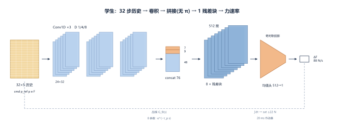

*图 3　学生策略的同构张量：输入仍是 32×5 历史，去掉显式特权量后的拼接维为 32 维（16+9+7），主干只有 1 个 32 宽残差块，共 3,856 参数。延迟表征实验的 SAE 分支见图 16。*

### 3.4 第四步：DHC-6 仿真数据小样本微调

目标域数据包含 12 个 DHC-6 仿真配平状态和 72 条 50 Hz 输入输出记录。依据 chirp 激励辨识各状态下的 ARX 模型，阶次范围为 na = 4–5、nb = 3–4、nk = 1，拟合 VAF 为 98.0%–98.7%。接口将策略输出的力速率积分为受 ±22 N 限幅的请求力，再按 δ = −(10/22)F 映射为副翼偏角；辨识模型输出的滚转角速度作为策略输入。

微调更新 75,040 参数 small 学生的全部权重。8 个状态用于适配，4 个状态留出用于检验跨状态泛化。优化执行 40 次 Adam 更新，学习率为 3×10^{−5}；训练损失统计响应开始 2 s 后的跟踪平方误差。闭环评估采用确定性策略、15 deg/s 正阶跃和 8 s 时域。

$$ \begin{gathered}e_k(W)=p_{\mathrm{ref},k}-p_k(W;\widehat G_{\mathrm{ARX}}),\\L_{\mathrm{DHC6}}(W)=\frac1{N_{t\geq2\mathrm s}}\sum_{t_k\geq2\mathrm s}e_k(W)^2,\\W_{m+1}=\operatorname{AdamUpdate}(W_m,\nabla_WL_{\mathrm{DHC6}};\eta=3\times10^{-5}).\end{gathered} \tag{13} $$

式中，Ĝ_ARX 为适配状态辨识得到的滚转通道模型，W 表示学生网络参数；留出状态仅用于微调后的闭环评估。

## 4 实验设置

源域实验包括教师训练、学生蒸馏和跨对象闭环评估；目标域实验在 ARX 辨识模型上微调 small 学生。表 2 汇总各阶段所用对象集和评估协议。各分组对应不同实验，按分组分别报告。

表 2　数据划分与评估协议

| 阶段 | 对象 / 数据 | 训练与留出 | 被评内容 |
| --- | --- | --- | --- |
| 对象库 | 5,000 个参数化滚转模型 | 4,500 个训练/同分布池；500 个分布外 | 参数范围与部分标签分布；联合缺口见 6.6 |
| PPO 教师 | 49 个源域对象 | 46/49 通过项目门限 | 确定性闭环跟踪与操纵 |
| 学生 | 48 个源域对象 | 44 个蒸馏；4 个留出，等级各 16 个 | tiny / small 跨对象性能 |
| DHC-6 微调 | 12 个仿真配平状态、72 条记录 | 8 个适配；4 个留出 | small 学生、单随机种子 |
| 库规模抽样 | 4,500 个非 OOD 对象池 | 每级随机抽 40 个，共 120 个 | tiny 学生，随机种子 20261023 |
| 幅值 / OOD | 300 个同分布对象、500 个 OOD 对象 | 14 条指令/对象；每指令重复 2 次 | tiny 学生固定权重，11,200 个对象—指令组合 |

源域 48 对象评估采用 30 条加权指令和每对象 64 条并行确定性轨迹；幅值扫描另以 14 条输入配置评估 300 个同分布对象和 500 个 OOD 对象，每个对象—指令组合重复两次。DHC-6 的适配和留出单元为配平状态，每状态以固定阶跃和单一策略种子评价。主线结果来自仿真或辨识模型，为单策略训练种子的归档结果；第 6 节另列两种子表示对照及三种子控制器路线验证。未开展实机飞行或完整飞控系统验证。

## 5 结果

### 5.1 第一步：采样对象的分布覆盖

参数库共含 5,000 个对象：4,500 个构成训练及同分布对象池，500 个作为分布外集合。图 4 展示八维参数中两两组合的采样位置，图 5 展示各参数边际分布和 49 个教师训练对象的位置。覆盖范围由实验设计给定；归档主线报告其中 49 个对象用于教师训练，第 6.5 节的 12 对象×3 种子实验单独列示。

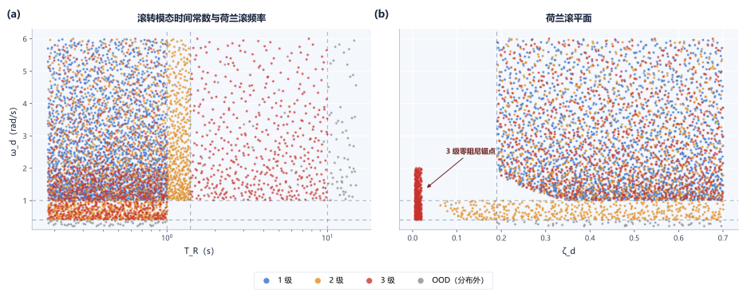

*图 4　5,000 个飞行品质对象的参数空间采样散点。颜色区分已实现判据的部分标签，标记区分训练与分布外对象。*

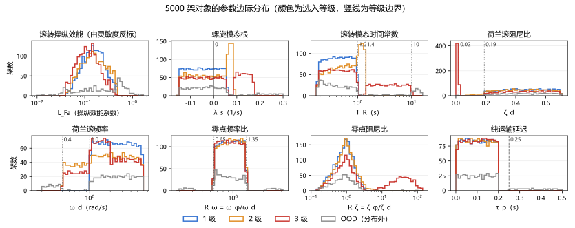

*图 5　参数边际分布及教师选取位置；仅 49 个对象进入逐对象教师训练。*

### 5.2 第二步：逐对象教师训练（归档报告值）

49 个对象分别训练后，46 个通过项目设定的 RMSE、峰值误差和请求力总变差率门限。未通过对象为
train_core-0174、train_core-0236、train_core-0467；统计保留全部训练尝试，未通过对象不从分母剔除。

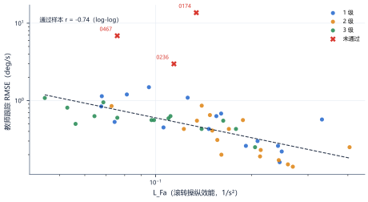

*图 6　教师跟踪误差与滚转操纵效能的关系（双对数）。颜色表示品质等级，红叉表示未通过对象；虚线为通过样本的拟合，相关系数 r = −0.74。*

通过对象中，滚转操纵效能 L_Fa 与跟踪 RMSE 呈负相关（双对数相关系数 r = −0.74）；三个未通过对象也位于低效能区域。

图 7 汇总 21 个具备逐轮固定验证记录的通过教师。其确定性验证 RMSE 随训练总体下降，最终选用 checkpoint 可来自中间训练轮次。

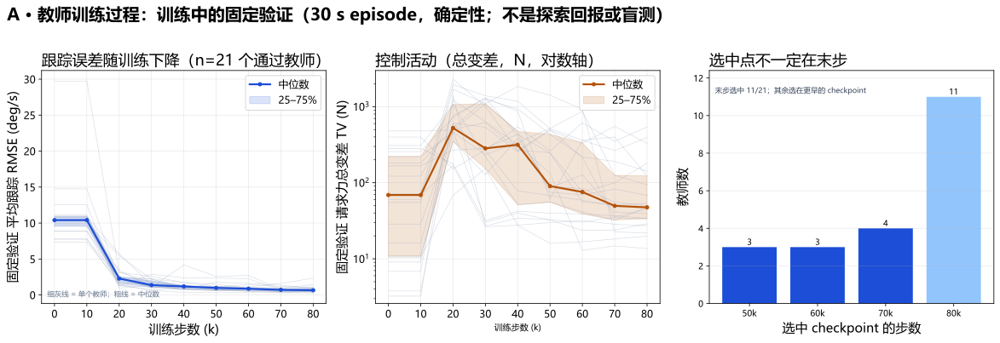

*图 7　21 个通过教师的固定验证 RMSE、操纵总变差及 checkpoint 选择过程。*

图 8 给出源域 L1、L2、L3 对象在阶跃与多正弦指令下的确定性闭环响应，包括参考角速度、对象响应及操纵量。
该图给出源域教师的闭环行为。

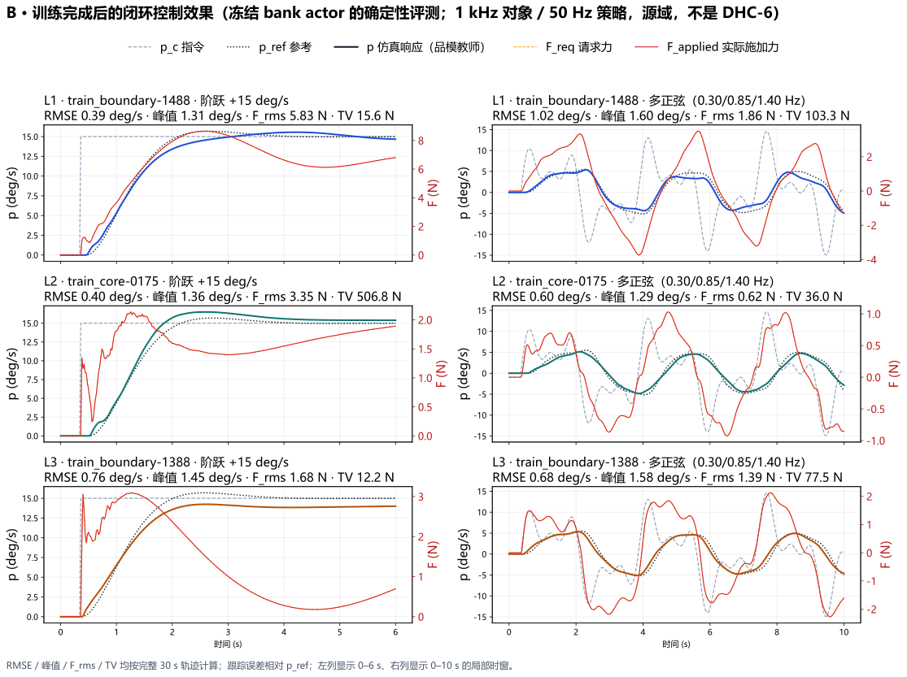

*图 8　教师训练完成后的源域闭环效果：不同品质等级的阶跃与多正弦响应。*

### 5.3 第三步：统一学生蒸馏（归档报告值）

原稿报告六轮 DAgger 后，tiny 的同分布/留出 RMSE 中位倍数为 1.28/1.68，small 为 1.34/1.41。这里统计的是逐对象“学生 RMSE/对应教师 RMSE”的中位数，不能与两组 RMSE 中位数之比混用。

| 学生 | 参数量 | 同分布通过 | 留出通过 | 同分布中位倍数 | 留出中位倍数 |
|---|---:|---:|---:|---:|---:|
| tiny | 3,856 | 37/44 | 3/4 | 1.28× | 1.68× |
| small | 75,040 | 38/44 | 3/4 | 1.34× | 1.41× |

扩大容量未改善同分布误差倍数，但留出倍数下降约 16.1%，通过数仍为 3/4。四个对象的二值通过数不足以排除容量作用。现有实验未独立控制容量、额外信息、教师覆盖及优化程度，因而不能把差距完全归因于特权信息，也不能称压缩无精度损失。逐对象 PPO 教师是经验比较基准，不是已证明的最优上界。

评估集含 48 个对象，三个等级各 16 个；44 个参与蒸馏，4 个为对象级留出。原稿规定每对象 30 条加权指令和 64 条并行确定性轨迹。完整主线逐对象与逐轮记录未随包提供，表中数字待相应原始证据补齐后才能独立复核。

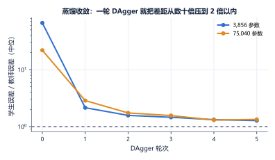

*图 9　原稿归档的学生蒸馏过程图；第 0 轮为行为克隆。其逐轮原始数据未随包提供，不能用 SAE 分支的新实验代替核验。*

### 5.3.1 代表性闭环响应

图 10 把教师与学生放在同一组指令下对比。六档阶跃上两者的上升段几乎重合，学生的稳态跟踪误差约为教师的 2.3–3.3 倍；双脉冲与多正弦上倍数降到 1.5–1.9，但幅值衰减更明显。这是该对象的行为差异，尚不能据此确定误差来自哪一类缺失信息。

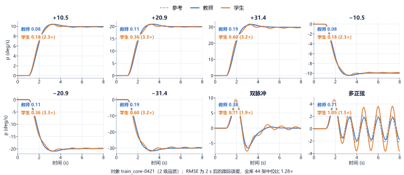

*图 10　教师与学生的时域对比（对象 train_core-0421，同一组指令）。虚线为参考，蓝线为教师，橙线为学生；面板内给出 2 s 后的跟踪 RMSE 及学生相对教师的倍数。六档阶跃上学生倍数约 2.3–3.3，形状指令上降到 1.5–1.9。*

### 5.3.2 扩展对象池抽样评估

为检查原 48 对象结果对更大样本的代表性，从 4,500 个非分布外对象中按品质等级分层抽取 120 个对象（每级 40 个，随机种子 20261023），并以 3,856 参数 tiny 学生进行确定性闭环评估。该 120 对象集与原 48 对象学生评估集不重叠，但来自同一非分布外对象池，故属于新增的同分布抽样评估，不是分布外测试。

按相同 RMSE、峰值误差和请求力总变差率门限，整体通过 94/120（78.3%）；RMSE 中位数为 0.64 deg/s，90 百分位为 2.24 deg/s。三个等级的通过数分别为 34/40、30/40 和 30/40。与原 48 对象结果相比，该抽样通过率较低；由于对象抽样集合和数量不同，不能把通过率差异直接解释为同一总体性能的下降。

在这 120 个对象中，跟踪 RMSE 与滚转操纵效能的相关系数为 −0.47。长滚转时间常数段（T_R > 6 s）
的 4 个对象中 1 个通过，是当前失分最集中的区间，
也是下一步补测的对象。批量评估不需要 GPU：同一学生权重在 CPU 上以 40 个进程并行评估这些对象，总耗时约 58 s，
单核即可推理。

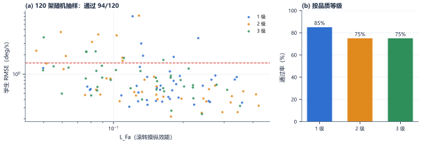

*图 11　120 个分层随机抽样对象的闭环评估。(a) 跟踪 RMSE 与滚转操纵效能；(b) 按品质等级统计的门限通过率。*

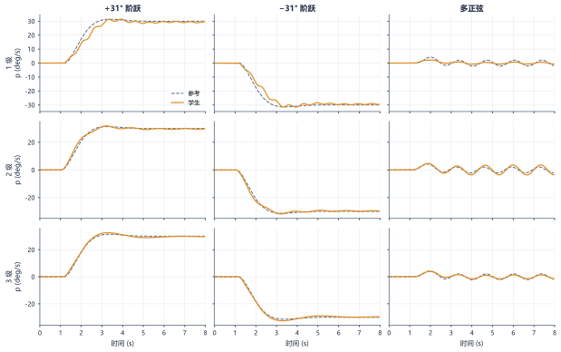

*图 12　同一 tiny 学生在三个源域对象和三类指令下的闭环响应。行表示品质等级，列表示指令；虚线为参考，实线为学生。*

图 12 展示固定对象 train_core-0000、train_core-0421 和 train_core-0701 在正、负阶跃及多正弦指令下的响应。三个对象的瞬态跟踪差异可见。

### 5.3.3 指令幅值与分布外对象评估

进一步评估学生在不同指令幅值及分布外对象上的表现。按品质等级从 4,500 个非分布外对象中抽取 300 个（每级 100 个），并纳入全部 500 个分布外对象；对每个对象测试 ±1、±2、±5、±10、±21 和 ±31 deg/s 六档阶跃、一个双脉冲及一个多正弦，共 11,200 个对象—指令组合。每一组合在仿真中重复两次，共运行 22,400 条轨迹；统计按脚本导出的组合级结果计算。三项门限与前文一致。

同分布样本中，±1 deg/s 阶跃通过率为 99.7%，RMSE 中位数为 0.11 deg/s；±31 deg/s 阶跃通过率为 60.3%，RMSE 中位数为 1.13 deg/s。双脉冲和多正弦通过率分别为 99.0% 和 99.7%。通过率随幅值增加而下降，大幅值段的请求力限幅（±22 N）和动作速率限制（88 N/s）可能参与约束响应。现有幅值比较未独立改变执行机构边界，尚不能确定饱和与其他误差来源各自的贡献。

在 500 个分布外对象上，±1 deg/s 和 ±31 deg/s 阶跃的通过率分别为 86.8% 和 27.6%，对应 RMSE 中位数为 0.21 和 2.93 deg/s。该结果表明，当前小型学生在较大幅值及分布外参数组合下性能下降明显。幅值测试中的 300 个同分布对象与前述 48 对象学生评估集不重叠；该测试评估的是固定学生策略，不包含目标域微调。

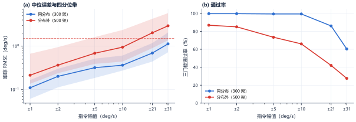

*图 13　学生响应随指令幅值的变化。蓝为 300 架同分布对象，红为 500 架分布外对象；(a) 中位误差与四分位带（虚线为门限），(b) 三门槛通过率。*

### 5.3.4 与固定增益 PID 的对照

为判断上述边界是否是“学习控制器特有”，在同一批对象（300 同分布 + 500 分布外）和同一批指令上
运行一个经典基线：二阶自由度 PID，含参考前馈、抗积分饱和，输入为力请求（±22 N），再折算成同一
力速率接口。增益在对象 train_core-0421 上做网格搜索得到（k_p=128、k_i=60、
k_d=0.8、k_ff=6.0），此后不再调整，即无增益调度。学生使用多对象训练，而该 PID 仅在一个对象整定，因此本对照只支持相对于这套固定 PID 的结果，不能代表相同对象族联合整定或增益调度方法的最优性能。

按同一门限判定，学生在所列幅值组的汇总通过率更高：同分布 ±1 为 99.7% 对 80.0%，±31 为 60.3% 对 35.7%；
分布外差距更大，±1 为 86.8% 对 46.6%，±31 为 27.6% 对 16.2%。PID 的零样本失效集中在分布外对象：
分布外各幅值组的中位 RMSE 为 8.8–18.5 deg/s，学生在同一批对象上为 0.21–2.93 deg/s。小幅值段 PID 的中位误差更低
（0.06 对 0.11），但其峰值与力变化率越界，因此门限通过率反而更低——两者在“精度”与“合格”上不是同一口径。

本对照说明所选固定 PID 与已训练学生在当前对象族中的差异，不能推出常规控制器必然需要逐对象整定，也未验证学生在实际跨机型部署中免于接口标定或再训练。

### 5.4 第四步：DHC-6 仿真目标上的小样本微调（归档报告值）

在归档的 15 deg/s 正阶跃、8 s 时域及 ARX 目标模型下，small 的八个适配状态 RMSE 中位数由 2.913 降至 0.595 deg/s，四个留出状态由 2.662 降至 2.148 deg/s，分别降低 79.6% 与 19.3%。后者描述当前留出状态上的改善，不代表实机或其他指令条件的泛化。

tiny 适配后中位误差为 1.574 deg/s，small 为 0.595 deg/s，前者约为后者的 2.65 倍。但源域初始化性能、网络容量和优化过程未独立控制，不能由此确定“源域容量无关、目标域容量敏感”的分工，更不能直接给出不同规模模型的部署建议。每状态五次更新只是原稿 40 步循环访问八状态的预算说明；尚无增加步数的受控实验来证明其必然改善性能。

本包缺少该 small 模型及 40 步主线的完整原始记录。表 4—5 与图 14—15 保留为归档报告，待原始证据补齐后核验；不使用同包另一模型的 64 步旧协议替代。

表 4　DHC-6 仿真微调前后跟踪误差（中位数）

| 状态组 | 样本数 | 微调前 RMSE（deg/s） | 微调后 RMSE（deg/s） | 相对变化 |
| --- | --- | --- | --- | --- |
| 适配 | 8 | 2.913 | 0.595 | 下降 79.6% |
| 留出 | 4 | 2.662 | 2.148 | 下降 19.3% |

表 5　两种容量学生在 DHC-6 上的微调前后（中位 RMSE，deg/s）

| 学生 | 参数量 | 适配前 | 适配后 | 留出前 | 留出后 |
| --- | --- | --- | --- | --- | --- |
| tiny | 3,856 | 4.127 | 1.574 | 2.778 | 2.624 |
| small | 75,040 | 2.913 | 0.595 | 2.662 | 2.148 |

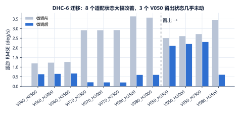

*图 14　DHC-6 仿真 ARX 对象上的微调前后对照（15 deg/s 阶跃）；虚线区分适配与留出状态。*

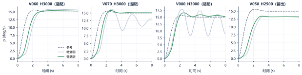

*图 15　代表性 DHC-6 仿真状态的微调前后闭环响应。适配状态微调后贴合参考；留出状态保持原策略的响应形态。*

## 6 讨论

归档源域结果报告，49 个逐对象教师中多数达到项目门限；然而统一学生的 RMSE 中位数仍高于对应教师，且 4 个留出对象中仅 3 个通过。120 对象扩展抽样的通过率为 78.3%，幅值扫描则显示，±31 deg/s 阶跃通过率从同分布样本的 60.3% 降至 OOD 样本的 27.6%。在所选固定增益 PID 的对照中，学生策略在分布外对象上的退化幅度较小，但在同分布小幅值段的精度不及经过前馈整定的 PID。这些结果共同表明，蒸馏能够将策略压缩至数千参数并保留大部分常规响应能力，但学生策略对对象参数和指令幅值仍敏感。

DHC-6 的归档适配数字来自两个不同规模的学生。small 的适配组改善大于留出组，tiny 的适配后误差也高于 small；这提示当前容量和更新配方可能影响目标域适配，但不构成容量或预训练收益的独立因果证据。目标对象来自 DHC-6 仿真记录的 ARX 辨识模型，未验证完整横航向耦合、状态估计误差或实际控制器接机。原 small 结果没有这些受控对照；第 6.5 节另对新的 3,856 参数学生补齐同预算随机初始化与冻结策略比较，不能归为旧 small 实验的复现。

飞行品质在本工作中用于源域参数化、覆盖设计和部分事后评价。归档奖励没有逐项加入 GJB 条款，因此当前可支持“在飞行品质相关参数化对象上训练控制器”，不能支持“已用 GJB 品质指标直接优化并证明符合性”。

### 6.1 延迟表征与等效延迟的核验

#### 6.1.1 数据与输入条件

归档 SAE 分支使用 510 个对象：训练/验证/测试分别为 300/90/120 个，每组在短（τp≤0.05 s）、中（0.05<τp≤0.15 s）、长（τp>0.15 s）时延层均分。每对象运行六档正阶跃（1、2、5、10、21、31 deg/s）、双脉冲、多正弦，共八条指令，产生 489,600 个历史窗口。这里不是主线正负六档的十四指令扫描。

本次用原 tiny 权重及 legacy_plant 参考重建全部对象，检查对象清单相同、4,080 个对象—指令的通过/失败判定没有变化。跨平台数值差异的最大 RMSE 为 0.00063 deg/s，峰值差约 0.00283 deg/s，TV 差约 0.00094 N/s。重建数据保留为独立版本，不覆盖归档数据。测试对象与训练对象分离，但其行为策略来自已有 tiny，不能将整个项目所有历史暴露等同于此处对象划分。

SAE 将 160 维展平历史编码为 16 维；PCA、稠密 AE、稀疏 AE、原始历史和互相关作为对照。互相关使用请求力、响应和指令，不直接读取参考信号，但产生轨迹的策略在归档模式下使用对象相关参考。探针成绩是当前仿真与行为策略中的可解码性，不是闭环改善或参数完全可辨识的证明。

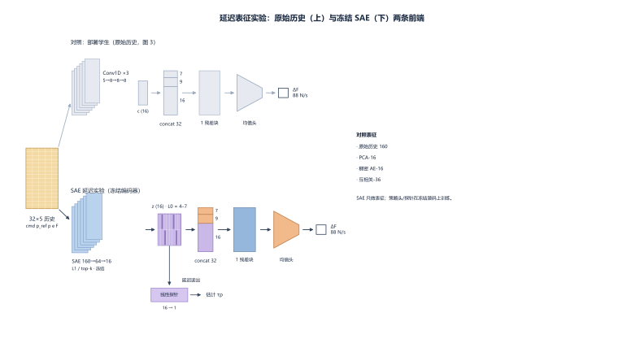

*图 16　原始历史与冻结表示的结构。编码器是否可训练、初始化以及参考构造均是实验条件，不能仅因输出同为 16 维就认为容量完全一致。*

#### 6.1.2 严格时间截止后的延迟探针

原脚本把 1.2 s 的决策步 60 强制抬到首个后续记录步 61，实际使用了 1.22 s 的样本。因此撤回原 0.995/2.9 ms 作为“1.2 s 因果结果”的表述。修订后从 1.0 s 指令起始时刻累积历史窗口，严格要求窗口时间不超过查询时间；1.2 s 查询的最新可用记录为 1.16 s。统计窗的起点也明确为 1.0 s，不能把新旧分数之差全部解释成单独 20 ms 的作用。

重建数据、原冻结编码器和按对象划分的训练/验证/测试用于重新拟合线性探针。结果如下，R² 与 MAE 均在 120 个测试对象、960 个对象—指令 episode 上统计。

| 表征 | 1.2 s R² | 1.2 s MAE (ms) | 2.0 s R² | 2.0 s MAE (ms) |
|---|---:|---:|---:|---:|
| 互相关 | 0.984 | 5.6 | 0.974 | 8.1 |
| 稠密 AE-16 | 0.443 | 41.3 | 0.661 | 29.2 |
| 原始历史 | 0.426 | 42.4 | 0.586 | 33.0 |
| PCA-16 | 0.388 | 44.2 | 0.552 | 35.3 |
| L1-SAE（较弱稀疏） | 0.301 | 47.7 | 0.558 | 35.2 |
| Top-k SAE-16 | 0.150 | 52.6 | 0.498 | 38.1 |
| L1-SAE（较强稀疏） | 0.018 | 58.0 | 0.485 | 38.1 |

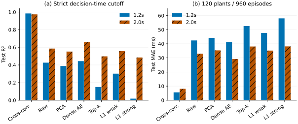

*图 17　严格按决策时间截止重新计算的延迟探针。柱表示指定查询时刻的结果；窗口不跨越查询时间。原 1.2 s 标注的归档结果仅作错误追溯。*

互相关在这一协议下仍优于所比较的线性读出表示。稠密与稀疏编码存在差异，但尚未隔离编码维数、损失函数和稀疏约束的全部作用。不能从这些结果推出“16 维一定足够”，也不能据此直接选择闭环控制输入。是否改善控制，应由独立闭环对照判断。

#### 6.1.3 归档闭环结果的正确解释

下表保留归档三档时延测试的描述性结果。每档 40 个对象×8 条指令，共 320 个 episode；通过率不是“通过对象数/40”。

| 变体 | 短时延通过率 | 中时延通过率 | 长时延通过率 | 长时延 RMSE 中位 (deg/s) |
|---|---:|---:|---:|---:|
| raw_ft | 93.1% | 95.3% | 90.0% | 0.408 |
| PCA-16 | 60.0% | 60.3% | 51.6% | 1.406 |
| 稠密 AE-16 | 69.1% | 72.5% | 63.7% | 0.731 |
| Top-k SAE-16 | 85.6% | 79.7% | 71.9% | 0.708 |
| SAE-aux | 93.1% | 95.6% | 90.0% | 0.409 |

raw_ft 与 aux 继承已有 tiny，替换分支随机初始化；raw_ft 没有本阶段追加采集，其余分支执行一次采集后训练八个 epoch。标签来自已有 tiny，并非直接查询原始逐对象 PPO 教师。实际采集动作是教师与学生动作的确定性加权混合，β=0.5 表示学生权重；这些实验不应称为八轮原始 DAgger。

旧“仅短/中时延训练→长时延”列不再用作跨时延留出证据：其编码器接触过长时延对象，部分分支继承既有策略，且 dagger_retrain 又将所有训练对象的 BC 样本加入更新。因此该列连“策略更新全程限于短/中时延”的条件也不满足。原 JSON 保留追溯，新受限训练见第 6.2.2 节。

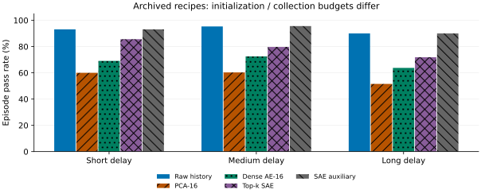

*图 18　归档闭环通过率。初始化和追加采集条件不同，结果只描述这些具体配方；原跨时延列撤出主图。*

#### 6.1.4 τp、τe 与标准适用范围

τp 是本研究对象输入前的运输延迟参数；τe 是对指定闭环频响拟合得到的等效延迟。后者依赖控制器、执行机构、参考模型及拟合协议，不能把 τp 的标签直接替换成 τe。

本研究采用所引 GJB 2874-1997 附录中的四阶滚转 LOES 形式^{[13]}：分母包含螺旋、滚转和荷兰滚模态，分子为三阶，再乘 exp(−τe s)。这说明本文采用的拟合结构，不表示所有对象都必然能由它充分描述。

A21 所列 0.10/0.20/0.25 s 在本文仅作为等效延迟的研究性阈值参照。当前输入为滚转角速度指令，评价对象、驾驶员回路和试验覆盖不等于标准符合性流程；RMSE/Peak/TV 与拟合残差门限均由项目设定。未通过拟合门的样本必须单列，不能赋 τe=0 或解释为延迟更好。

#### 6.1.5 修复时间对齐后的 LOES 评价

归档主批次为 120 对象×3 策略，短/中/长各 40，180 s 多正弦激励。频点由 0.1–10 rad/s 范围内的整数 DFT 栅格生成。原 run_case 保存 u(t_k) 与 p(t_k+0.02) 却按同一时间序号估计频响；因此输出相位含一个控制周期的超前。

本次对全部四批、1,440 个已存频响作 H_corrected(ω)=H_archived(ω)·exp(−jω·0.02)，再按原 16 起点、相同参数边界和随机种子重新拟合。拟合器增加了优化器成功退出检查。这里修复的是现有逐频估计的时间坐标，没有重新生成这 1,440 条轨迹，也没有将新实现的联合谐波回归结果混入本表。参考仍为归档 legacy_plant。

幅值指标实际是 R²_logmag=1−Σ(log|H_fit|−log|H|)²/Σ(log|H|−mean(log|H|))²，不是时域 VAF；项目门限为 R²_logmag≥0.95 且包裹相位 RMSE≤10°。只在过门样本中统计 τe 和阈值档位。

| 策略 | 可评 / 120 | τe 中位 (s) | 短 / 中 / 长中位 (s) | ≤0.10 | (0.10,0.20] | (0.20,0.25] | >0.25 |
|---|---:|---:|---|---:|---:|---:|---:|
| 原始历史 raw_ft | 73/120 | 0.093 | 0.062 / 0.147 / 0.319 | 39 | 18 | 3 | 13 |
| SAE-aux | 101/120 | 0.125 | 0.054 / 0.145 / 0.329 | 42 | 21 | 6 | 32 |
| Top-k SAE-16 | 0/120 | — | — / — / — | 0 | 0 | 0 | 0 |

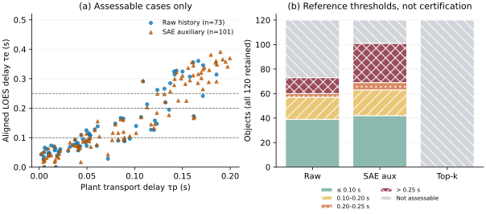

*图 19　对齐修复并重新拟合后的 τe。散点仅表示过门样本；右图完整保留未过门对象。档位是 A21 数值阈值参照，不是标准等级认证。*

raw 的可评数仍为 73，aux 从归档 102 变为 101；因此不能简单把所有摘要数值统一加 0.02 s。Top-k 仍为 0/120 可评，表示当前模型和门限不能给出合格估计，不能据此证明每条轨迹都失稳。

不同策略的可评集合不同。raw 与 aux 共同可评 71 个对象上的 τe 中位数分别为 0.09315/0.09480 s，配对差 aux−raw 的中位数为 -0.00447 s。两类中位数不是同一统计量；这组描述性结果不足以宣称哪种策略的飞行品质更好。长时延可评子集的中位 τe 约为 0.32–0.33 s，不能外推到所有长时延对象。

#### 6.1.6 幅值、种子与门限的范围

已完成的设计是种子 1 下三档幅值，以及种子 2 下基准幅值，共四种配置；不是完整的两种子×三幅值六格交叉设计。下表均由时间对齐后的重新拟合结果汇总。

| 策略 | 可评数（0.5 / 1.0 / 2.0 deg/s） | 各自可评集 τe 中位 (s) | 三档共同 n | 共同集三档中位 (s) |
|---|---|---|---:|---|
| 原始历史 | 41 / 73 / 92 | 0.085 / 0.093 / 0.112 | 40 | 0.082 / 0.086 / 0.075 |
| SAE-aux | 79 / 101 / 112 | 0.129 / 0.125 / 0.144 | 76 | 0.131 / 0.121 / 0.132 |
| Top-k SAE | 0 / 0 / 0 | — / — / — | 0 | — / — / — |

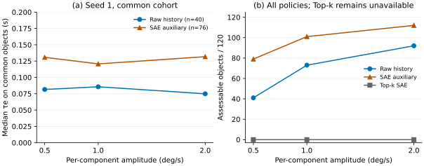

*图 20　时间对齐修复后的幅值检查。共同可评对象固定后比较 τe，并单独展示可评数量；未完成的种子—幅值配置不绘制。*

| 策略 | 可评数（种子 1 / 2） | 各自可评集 τe 中位 (s) | 两种子共同 n | 共同集两种子中位 (s) |
|---|---|---|---:|---|
| 原始历史 | 73 / 77 | 0.093 / 0.098 | 73 | 0.093 / 0.095 |
| SAE-aux | 101 / 106 | 0.125 / 0.126 | 100 | 0.122 / 0.119 |
| Top-k SAE | 0 / 0 | — / — | 0 | — / — |

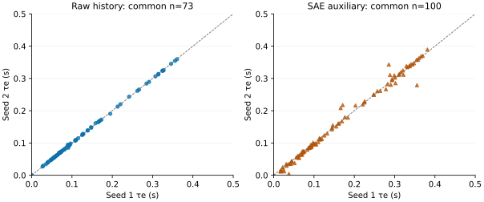

*图 21　基准幅值下两个策略种子的结果。仅在两种子共同可评对象上比较 τe，Top-k 的不可评结果单列。*

这些检查说明所测试配置中的表现，不提供跨训练种子总体、跨机型或标准审定的置信结论。幅值增大时可评比例变化可能与响应形态、非线性及拟合误差共同有关；没有独立噪声实验，不能把原因确定为信噪比提高。

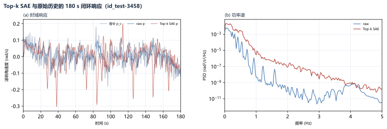

*图 22　保留的归档长时响应诊断例（id_test-3458）。该例可见 Top-k 低频振荡，但一个示例不等于全部 120 个对象的稳定性证明。时间坐标对齐不会改变该功率谱的幅值。*

### 6.2 修订后新增对照

#### 6.2.1 公共参考：同一冻结权重的配对检查

固定原 tiny 权重，在原 SAE 的 120 个测试对象、每对象八条指令上，分别提供 legacy_plant 与 fixed 参考。两组均使用同一个不延迟的二阶公共目标计算指标，并将 p(t_k+1) 与该时刻参考对齐。因此这是新定义、相同评价目标下的配对敏感性实验，不能与归档各自参考下的 90% 通过率直接比较。

| 分组 | 对象 / episode | 旧参考通过率 | 公共参考通过率 | RMSE 中位：旧/公共 (deg/s) | 通过率配对差及对象 bootstrap 95% 区间（百分点） |
|---|---|---:|---:|---|---|
| 全部 | 120 / 960 | 86.15% | 89.58% | 0.534 / 0.423 | +3.44 [1.88, 5.10] |
| 短时延 | 40 / 320 | 91.25% | 92.19% | 0.424 / 0.363 | +0.94 [0.00, 2.19] |
| 中时延 | 40 / 320 | 88.12% | 93.12% | 0.533 / 0.372 | +5.00 [2.81, 7.19] |
| 长时延 | 40 / 320 | 79.06% | 83.44% | 0.739 / 0.545 | +4.38 [0.31, 8.12] |

区间以对象为重采样单位，保留同对象八条指令的相关性，4,000 次 bootstrap，种子 20261024；不覆盖新的策略训练随机性。公共参考在该冻结策略、对象集和统一目标下提高了通过率。由于参考时延与导数计算方式共同变化，这不是某一个因素的独立效果，更不能据此宣称解决了所有未知动力学适应问题。它反驳的是“原有成绩必然全靠真实时延输入”这一未经验证的解释。

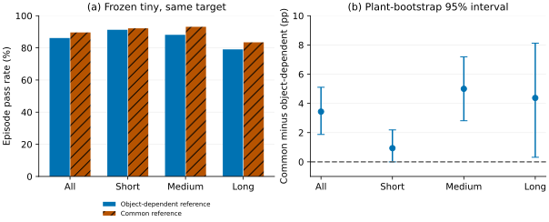

*图 23　公共参考与归档参考的配对检查。固定权重、相同对象与公共目标；差值区间按对象重采样。*

#### 6.2.2 训练范围受限、初始化与预算统一的学生对照

新增实验预先记录于 revision/fair_comparison_protocol.json。重新采集公共参考下的 510 对象数据；学生和编码器只在 200 个短/中时延 train_core 对象上更新，以 60 个短/中时延 validation 对象选取训练 checkpoint，在 40 个长时延 id_test 对象、320 个 episode 上评价。标准化、PCA、稠密 AE 和 Top-k AE 的拟合范围也只包含源时延层。

五种学生全部随机初始化，BC 20 个 epoch，随后两轮实际重新采集并聚合的交互式模仿，每轮八个 epoch、96 个合格源对象、相同批大小和学习率。两种策略种子为 20261024/20261025，冻结编码器共用同一套源域训练结果。监督者仍是已有 tiny，其完整预训练暴露不明，因此此处只能称学生及编码器训练范围受限，不能宣称整条知识来源从未见长时延。

| 学生 | 长时延通过率（种子 1 / 2） | 长时延 RMSE 中位（种子 1 / 2，deg/s） | 可训练参数数 |
|---|---|---|---:|
| 原始历史 | 63.44% / 66.56% | 0.843 / 0.891 | 3856 |
| PCA-16 | 69.69% / 58.75% | 0.739 / 0.939 | 3328 |
| 稠密 AE-16 | 65.31% / 56.88% | 0.663 / 1.054 | 3328 |
| Top-k SAE-16 | 57.50% / 57.81% | 1.039 / 0.992 | 3328 |
| SAE-aux | 67.50% / 64.38% | 0.748 / 0.840 | 4368 |

原始历史为 63.44%/66.56%，Top-k 为 57.50%/57.81%，aux 为 67.50%/64.38%。aux 在两个种子上的相对排序相反，没有显示稳定增益。这些新数值不能与旧 90% 直接相减来归因于单个漏洞，因为参考构造、初始化和训练范围均已改变。以上数字来自修订后实际重训；各模型仍存在架构和可训练参数差异，两个策略种子也不足以估计完整训练随机性。应保留每种子结果，不能用单次最好结果替代整体比较。此处没有新增品质分层采样对照、容量×信息的因子实验或真实飞机验证。

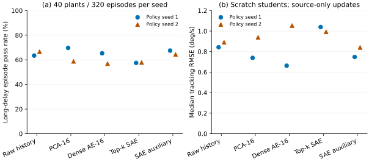

*图 24　修订协议下长时延测试的逐种子结果。学生/编码器训练范围受限，监督者历史暴露未认证；不与旧混合初始化结果合并统计。*

### 6.3 后续实验计划：执行机构敏感性

以下实验尚未开展，不属于本文结果。为检验当前执行机构设置是否影响策略表现，先在固定对象、随机种子和指令集上对现有策略做冻结权重敏感性扫描；若结果对参数明显敏感，再按相同训练预算分别重训 PPO，区分“环境变化造成的鲁棒性下降”与“策略能否适应新约束”。每次只改变一个因素，并同步记录教师验收率、RMSE、峰值误差、请求力总变差率、饱和比例，以及 DHC-6 适配组和留出组结果。

表 8　待开展的执行机构消融

| 因素 | 当前基线 | 计划对照 | 目的 |
| --- | --- | --- | --- |
| 请求力限幅 | ±22 N | ±16.5 N、±27.5 N | 评估控制权限范围变化的影响；桥接与目标舵面边界同步换算 |
| 命令速率限制 | 88 N/s | 44 N/s、176 N/s | 评估舵面速率变化对跟踪、平滑性和迁移的影响 |
| 执行机构滞后 | 一阶时间常数 20 ms | 0 ms、40 ms | 判断当前滞后假设是否改变闭环表现，并检查目标对象中是否重复计入执行机构动态 |

力限幅和速率限幅在当前桥接下分别对应副翼角度和速率边界，消融时需同步更新源域与目标域接口。后续还应扩大未参与教师训练的同分布和分布外测试集，并在相同对象、指令和安全约束下与常规滚转控制律对照。仿真级对照完成后，再逐步引入更高保真模型、滚转—偏航耦合和机载实时性评估。

### 6.4 品模与 PPO 的进一步核验（v2 阶段记录）

模型包含滚转、螺旋和荷兰滚因子；完整扫描件不同页面的公式差异及本文建模选择现于第 2.2 节明确说明。四维状态空间实现不等于完整飞机的物理状态。库中 2,101 个对象具有发散螺旋极点，这本身不必然违反所用判据；115 个滚转时间常数大于 8 s，619 个荷兰滚衰减时间常数大于 8 s。因此 0.75 s 建库筛查和 8 s 闭环跟踪都不足以证明长时稳定性。大幅值持续速率还可能超出局部小扰动模型的适用范围，需在耦合或非线性模型中另行检验。

一秒灵敏度的旧实现将积分前输出错放在下一采样时刻。修复后，train_core-0717 的 1 kHz 灵敏度由 3.375472 变为 3.380646 deg/N，标签 L1→L2；train_core-1081 由 5.619090 变为 5.629182 deg/N，标签 L2→研究 OOD／该项未分级。原参数和划分保留，并提供标签修正附表，不把历史训练成绩重命名为新标签协议的成绩。

PPO 的旧 act() 保存裁剪动作却保留裁剪前样本的 log_prob，使权重未改变时的概率比也可能偏离 1。固定 μ=0.95、logσ=−2 的人工反例中，10,000 次采样有 3,532 个裁剪样本，比率中位数为 1.440；这是实现反例，不是历史训练异常频率。修订采用同一原始样本计算新旧概率，仅在环境中裁剪物理动作。末值默认按有限任务置零；监控默认比较同一时刻参考和响应，旧参考区间口径保留为显式选项。

训练指令库的 30 个条目只有 9 条独立指令，阶跃/双脉冲/正弦/多正弦的条目数为 24/3/2/1，不能称为家族占比 4:3:2:1。v2 的 evaluate() 重用训练指令库，其 monitor 不代表独立测试；v3 现支持独立验证指令，已用于第 6.5 节。训练日志新增近似 KL、剪切比例、梯度范数、动作限幅比例、末值和逐指令指标，以便检查更新过程。

本次 18 项回归检查通过。另在一个对象、32 个并行环境上完成两次 PPO rollout，共 25,600 次转移，确认采集、GAE、更新、评价和权重保存流程可执行；训练库 RMSE 约 20.22 deg/s，未达到控制门限。没有重训原 49 个教师，也没有建立修复前后控制性能对照。完整理论依据、复算记录和复现入口见[品模与强化学习深查](../../flight_control_corrected_2026-10-24/02_品模与强化学习深查.md)。

### 6.5 飞控控制器路线的连续证据（2026-10-24 冻结实验）

本节研究主体是飞控控制器构建路线，滚转是可行性验证任务。全部对象、种子、指令和预算在训练前冻结。12 源对象按部分品质等级各4个并覆盖不同时延；24 ID、24 OOD均不参与训练或选模。36个新教师每个训练6,144,000次转移；三个学生各完成BC30 epoch与6次真实DAgger采集、每次8 epoch，保留全部源教师，最终每种子聚合1,075,200个状态。教师有12维特权输入；学生仅有176维公共参考与测量历史输入。新PPO奖励和历史显式采用same_time，旧区间口径仍保留供归档复现。

训练/验证/测试分别为32/16/18条互不重复的实际波形。教师以源对象独立验证指令在2.00–7.98 s窗口的平均RMSE选权重；学生以全响应源验证RMSE选轮次。正式测试从指令开始到真实末状态，二者不混报。以下门限为项目RMSE/Peak/TV联合通过条件，不是完整GJB品质评定。

| 种子 | 教师源对象，8 s | 学生源对象，8 s | 学生ID，8 s | 学生OOD，8 s |
|---|---:|---:|---:|---:|
| 20261031 | 82.4% (178/216) | 87.0% (188/216) | 68.1% (294/432) | 51.4% (222/432) |
| 20261101 | 61.1% (132/216) | 63.9% (138/216) | 52.8% (228/432) | 40.7% (176/432) |
| 20261102 | 61.1% (132/216) | 48.1% (104/216) | 40.7% (176/432) | 38.9% (168/432) |

学生/教师逐案例RMSE中位倍数分别为1.140/1.027/1.324（只在教师RMSE≥0.05 deg/s的214/216配对上计算）。通过率变化分别为+4.63/+2.78/−12.96个百分点，不能据此宣称无损蒸馏。多轮训练中存在误差反弹；本次未做等计算量BC消融，不能将全部变化单独归因于DAgger。

三个种子的源域平均 RMSE 均低于对应教师，但第三种子的门限通过率下降。这些统计量回答不同问题：逐案例 RMSE 的算术平均、逐案例误差比的中位数，以及多指标共同达标的比例，不能互相替代。各轮源验证结果如下，单位为 deg/s；最优轮次由验证集决定。

| 种子 | 初始 BC 验证 RMSE | 选中蒸馏轮次 | 选中轮次 RMSE | 第 6 轮 RMSE |
|---|---:|---:|---:|---:|
| 20261031 | 4.668 | 6 | 0.960 | 0.960 |
| 20261101 | 6.895 | 5 | 1.380 | 1.528 |
| 20261102 | 10.908 | 4 | 2.088 | 2.191 |

统一固定抗饱和PID以全部12源对象的独立验证指令选参，选中Kp=45、Ki=24、Kd=1；8s的ID/OOD通过率为53.7%/27.8%，OOD有18/432个episode发散。该PID仍是有限网格搜索基线，不代表最优常规控制。学生在OOD上的优势与自身失效应同时报告。

为检验持续控制，另外运行30s的±15 deg/s阶跃和相同初始偏差/扰动恢复。对完全相同的两阶跃，教师源对象通过率从8s的75.0%/50.0%/50.0%降至30s的16.7%/25.0%/16.7%；学生变化并非各组一致，但同一个OOD对象在三个种子的正负阶跃中共出现6次长回合发散。恢复评价采用同偏差/同脉冲有控—无控配对、释放后RMS和带截尾的稳定时间；不把峰包络或有限时域未发散当作模态稳定性证明。

测试后补充的任务可达性诊断发现，当前模型有原点零点且所选对象λs非零，长期非零恒定p0的精确跟踪力满足dF/dt→−λs p0/(L_Fa T_R R_omega²)。放宽执行机构和时延约束后，30s精确参考跟踪仍有4/12源、5/24 ID、4/24 OOD对象需要超过22N。上述发散对象ood_test-4700在约18.01s越限，30s理想需求44.17N；因此长期失效不能全部归因于RL。精确跟踪不可达不等于非零RMSE/Peak容差不可达，主测试分母保持不变。恢复负结果也保留：第三种子OOD扰动释放RMS有36/48配对高于无控。后续必须同时改进任务可达性定义与恢复控制，不能仅延长恒定速率训练。

目标适配修复旧35维绝对力接口与新176维增量力学生不一致的问题。在8个DHC-6条件中各取30s辨识数据，两可训练组均执行64次完整轨迹梯度更新、819,200次模型内转移；网络、优化器、指令和条件顺序相同，最终步固定评价。测试使用独立记录辨识的12个ARX对象，8适配与4留出条件分列。以下为4留出条件×18指令：

| 种子 | 冻结源学生 | 预训练后适配 | 同预算从零训练 |
|---|---:|---:|---:|
| 20261031 | 44.4% (32/72) | 75.0% (54/72) | 58.3% (42/72) |
| 20261101 | 63.9% (46/72) | 75.0% (54/72) | 63.9% (46/72) |
| 20261102 | 30.6% (22/72) | 80.6% (58/72) | 61.1% (44/72) |

三个种子方向一致，支持该模型辅助适配配方的有限收益。目标更新是可微模型上的梯度适配，不是目标域PPO，也不是64次实飞交互。源域预训练成本不包含在等目标预算内。品质采样、特权信息和容量的独立收益仍需要消融，不能从本节直接确认。

完整逐种子表、学习曲线、失败轨迹、恢复配对、理论边界、接口和复现命令见[控制器路线验证与最佳实践](../../flight_control_corrected_2026-10-24/03_控制器路线验证与最佳实践.md)，原始统计见[完整新实验数据](evidence/controller_route_report_summary.json)。

### 6.6 完整 GJB 核查与对象库覆盖审计

本节属于训练后数据与方法审计，不是新控制器对照实验。对全部 5,000 个历史对象的统计按历史标签计算，已知的两条灵敏度跨界记录另列；原参数和划分未改变。依据见[覆盖统计](evidence/gjb_audit/coverage.json)及[原 PDF 校验记录](evidence/gjb_audit/source.json)。

| 检查项 | 实际结果 | 对结论的约束 |
|---|---:|---|
| 非 OOD 的分量等级组合 | 8 种 / 54 格诊断网格 | 总等级均衡不代表联合覆盖 |
| 全库两项及以上已分级指标同时退化 | 0 / 5,000 | 未验证这些组合下的学习与泛化；零点、增益、延迟仍在变化 |
| 荷兰滚二级且 ω_d≥1 rad/s | 0 / 5,000 | 遗漏频率合格但阻尼或乘积不足的区域 |
| 0.20<τ_p≤0.25 s | 0 / 5,000 | 域内和域外设置之间存在空档 |
| train_boundary | 未按边界距离选点 | 不能解释为专门的边界加密 |
| 旧辅助振荡比恰为 0 / 1 | 4,358 / 641 个 | 0.75 s 窗口与缺峰补零使其缺乏品质解释 |
| 旧调节时间恰为 0.749 s | 4,999 个 | 返回末端超限时刻，未确认进入并保持在容差内 |

考虑延迟后，全部对象的建库窗口都不足一个完整荷兰滚周期。GJB 正文 3.6 要求有符号峰谷，并按 ζ_d≤0.2 与 ζ_d>0.2 使用不同极值公式；缺峰或未处理螺旋分量时不能补零认定无振荡。调节时间须定义目标、容差及最短保持时间，未证实时记为截断。当前可先用滚转时域超调、残余 RMS、恢复包络及饱和/发散率评价抑振，不能据此伪造含侧滑相位条件的完整等级。

500 个 OOD 中，160 个仅因 L_Fa 超出研究范围；OOD 不自动表示品质更差。旧 R_ω 域外采样在二分支内未重新缩放随机变量，实际范围约为 [0.30,0.424] 与 [2.121,3.0]，不同于名义区间。后续 OOD 协议应明确越界原因和采样规则，不能将这一问题隐入总通过率。

根据第 3.1.2 节规则，已生成[190 对象构造样例](evidence/gjb_audit/pilot_joint_v1/manifest.json)：训练、验证、ID 各 54 个联合组合，另有 14 组、28 个距活动阈值 ±2% 的边界探针；其中 138 个同时退化至少两项，44 个为高频二级荷兰滚，39 个位于 0.20–0.25 s 延迟段。[238 项检查](evidence/gjb_audit/verification.json)通过，覆盖峰谷公式、截断、真实跨级边界、1 ms 灵敏度回放、参数唯一性和旧库不变性。

上述样例没有新的 OOD 套件，边界探针也尚未分配训练或测试角色；物理可实现性、任务可达性和策略学习效果尚未验证。等组合配额改变了总体等级比例，不能直接替换历史库后比较通过率。这里证明的是构造规则可复算，不能声称已改善控制性能。

## 7 结论

本研究把品质相关参数化对象、特权教师、统一学生和目标域适配作为飞控控制器构建路线，以滚转通道检验可行性。已完成的三种子实验补齐了连续链路：教师可训练、统一学生可闭环使用，等目标预算下预训练适配优于从零训练，但教师与蒸馏的种子差异、源外退化和长时发散仍明显。结论应为“有阶段性可行性证据，可靠性尚不足”，不应概括为无损压缩或通用稳定。

已直接修复参考读取真实时延、PPO动作概率不一致、终止后取reset价值、历史与奖励时间错位、蒸馏采样回流及目标接口不一致等问题。新结果属于明确的新协议，不能用于追认缺少源码版本的旧49/46教师与small迁移数值，也没有隔离每个代码修复的性能贡献。

既有数据复核继续保留：严格1.2s探针R²=0.984、MAE=5.6ms；相位修正后raw/aux的τe可评子集中位数为0.093/0.125s，须同时看可评集合，Top-k不可评不等于零延迟或普遍失稳。两种子表示对照未显示稳定SAE辅助收益。

下一阶段应先明确满足模型零点与力限制的可达机动，再提高教师与学生训练重复性和长时恢复表现，通过预先声明的对照分离品质采样、信息条件与容量的作用。其他通道、耦合模型和实机验证是此后的扩展；现阶段只做滚转本身不是路线缺陷。

完整 GJB 核查进一步表明，当前对象库的联合覆盖不足、旧辅助振荡及调节时间量不能作为可靠品质证据。新联合构造样例修正了部分覆盖规则，但尚未开展策略训练；因此本文保留原协议的控制成绩，并将构造验证、训练优化和最终品质验收明确区分。

## 附录 A 数学符号与计算示例

本附录帮助读者把公式与实际控制量对应起来。A.1、A.4 的简化动力学仅作教学推导；A.2 使用当前实际奖励系数，A.3 说明实际优化目标的计算方式，均不产生新的控制性能证据。

### A.1 从变化率到传递函数

设参考滚转速率为 10 deg/s，测得 7 deg/s，则 e=3 deg/s。ṗ 表示速率的变化率；若 0.02 s 内 p 从 7 变成 7.1 deg/s，其平均变化率为 5 deg/s²。积分将变化累积，例如误差持续为 3 deg/s、历时 2 s，其积分为 6 deg。

用一个一阶教学模型说明对象计算：

$$ \dot p=-p/T_R+bF,\qquad p_{k+1}\approx p_k+\Delta t\,(-p_k/T_R+bF_k). \tag{A1} $$

取 p=7 deg/s、T_R=0.5 s、b=8 deg/(s²·N)、F=2 N，得到 ṗ=−14+16=2 deg/s²，用一步近似得 20 ms 后 p≈7.04 deg/s。该近似不替代正文四阶对象的离散仿真。

在零初始条件下，求导的拉普拉斯变换对应乘 s，故：

$$ sP(s)=-P(s)/T_R+bF(s)\quad\Longrightarrow\quad P(s)/F(s)=b/(s+1/T_R). \tag{A2} $$

s 是变换域变量，不是时间 t；P(s) 与 F(s) 表示信号的变换。非零初始条件需另加自由响应。类似地，一项欠阻尼振荡可写为：

$$ q(t)=A\exp(-\zeta_d\omega_dt)\cos\!\left(\omega_d\sqrt{1-\zeta_d^2}\,t\right). \tag{A3} $$

固定 ω_d=2 rad/s，ζ_d=0.1 时四秒后的包络剩 exp(−0.8)≈44.9%；ζ_d=0.5 时剩 exp(−4)≈1.83%。cos 决定往复摆动，指数决定包络衰减；该例隐含特定初始相位，不是整个对象的阶跃响应。

### A.2 动作与奖励的代入

式 (6) 中若请求力为 5 N、动作 a=0.1，新请求力为 5+1.76×0.1=5.176 N；原请求力为 21.9 N 时，同一动作经过限幅后只能到 22 N。a=0 保持请求力，施加力还受执行机构和延迟影响。

另取一条已给定的样本，其误差为 3 deg/s、施加力 11 N、动作 0.1，则式 (7a) 的奖励为：

$$ r=-\left[(3/30)^2+0.02(11/22)^2+0.1^2\right]=-0.025. \tag{A4} $$

三项代价为 0.01、0.005、0.01。相除统一了量纲，平方使正负偏差都计入代价；负号使较小代价对应较大奖励。这不表示动作 0.1 会立即产生 11 N。减小当前动作虽可减少动作代价，之后的误差是否增大仍需由对象演化决定，因此教师优化累计回报。

### A.3 优势、裁剪和权重更新

若 r=−0.1、γ=0.995，Critic 对当前与下一状态的预测分别为 −5 和 −4，则 δ=−0.1+0.995×(−4)−(−5)=0.92。结果比预期好时，差值可为正，而即时奖励仍为负。GAE 加权汇集这些差值来估计优势。

对正优势 Â=2 的样本，ρ=1.1 时式 (9) 中被取负前的贡献为 2.2；ρ=1.4 时裁剪分支为 1.2×2=2.4，min 选择 2.4，而非 2.8。这限制特定方向上继续改变该样本密度的激励，并非稳定性证明。

优化器用损失对权重的导数决定调整方向。最简单的梯度下降写成 w_new=w−η∇_wL：η 为学习率，∇_wL 表示各权重微小改变对损失的局部影响；实际程序用 Adam。调整 w 的训练过程，与每 20 ms 输入观测得到动作的部署过程不同。

### A.4 蒸馏误差、闭环累积与信息限制

教师动作 0.2、学生动作 0.1 时，一条样本的平方损失为 0.01；学生改成 0.18 时损失为 0.0004。这说明动作接近程度改善，尚不直接说明轨迹改善。

令 d 表示两条轨迹的状态差值，以无量纲的教学递推说明误差传播，初始 d₀=0、输入增益设为 1、每步固定动作偏差 ε：

$$ d_{k+1}=g\,d_k+\epsilon,\qquad d_n=\epsilon\sum_{i=0}^{n-1}g^i. \tag{A5} $$

当 g=0.9、ε=0.01 时，d_n 趋近 0.1；g=1 时线性累积为 nε；g=1.05 时持续放大。g 是教学模型的误差传播系数，不是当前网络已测得的稳定性指标。DAgger 在学生实际访问的状态上追加教师标签，针对的是这种状态分布变化，不能保证每一轮改善。

若两种隐藏情况对学生呈现相同观测和历史，等频教师标签却分别为 +0.5、−0.5，则平方损失为 [(a−0.5)²+(a+0.5)²]/2=a²+0.25，其最小值在 a=0。该例说明重复蒸馏无法凭空恢复缺失信息；项目是否实际存在此类冲突，仍需数据诊断。

## 参考文献

1. GJB 185-1986. 有人驾驶飞机（固定翼）飞行品质[S]. 北京: 国防科学技术工业委员会, 1986.

2. MIL-STD-1797A. Flying qualities of piloted aircraft[S]. Washington: Department of Defense, 1990.

3. J. Schulman, F. Wolski, P. Dhariwal, et al. Proximal policy optimization algorithms[J]. arXiv:1707.06347, 2017.

4. S. Ross, G. Gordon, D. Bagnell. A reduction of imitation learning and structured prediction to no-regret online learning[C]. AISTATS, 2011.

5. V. Vapnik, A. Vashist. A new learning paradigm: learning using privileged information[J]. Neural Networks, 2009, 22(5-6): 544-557.

6. L. Pinto, M. Andrychowicz, P. Welinder, et al. Asymmetric actor critic for image-based robot learning[C]. Robotics: Science and Systems, 2018. DOI: 10.15607/RSS.2018.XIV.008.

7. J. Lee, J. Hwangbo, L. Wellhausen, et al. Learning quadrupedal locomotion over challenging terrain[J]. Science Robotics, 2020, 5(47).

8. T. Miki, J. Lee, J. Hwangbo, et al. Learning robust perceptive locomotion for quadrupedal robots in the wild[J]. Science Robotics, 2022, 7(62).

9. A. Kumar, Z. Fu, D. Pathak, et al. RMA: Rapid motor adaptation for legged robots[C]. Robotics: Science and Systems, 2021.

10. M. O'Connell, G. Shi, X. Shi, et al. Neural-Fly enables rapid learning for agile flight in strong winds[J]. Science Robotics, 2022, 7(66): eabm6597. DOI: 10.1126/scirobotics.abm6597.

11. E. Kaufmann, L. Bauersfeld, A. Loquercio, et al. Champion-level drone racing using deep reinforcement learning[J]. Nature, 2023, 620: 982-987.

12. J. Eschmann, D. Albani, G. Loianno. Learning to fly in seconds[J]. IEEE Robotics and Automation Letters, 2024.

13. GJB 2874—1997. 电传操纵系统飞机的飞行品质[S]. 本次直接核对用户提供的 414 页扫描 PDF，重点为正文 3.6、4.9、5.4，以及附录 A 的分类、LOES、A18/A19/A20/A21/A31/A35 与滚转振荡相关说明；页面和哈希见 [source.json](evidence/gjb_audit/source.json)。此阅读范围不等于全部条款符合性审定。

14. J. Eschmann, D. Albani, G. Loianno. RAPTOR: A Foundation Policy for Quadrotor Control[J]. Science Robotics, 2026, 11(114): eaec1481. [原文](https://arxiv.org/abs/2509.11481).

15. D. Zhang, A. Loquercio, J. Tang, et al. A Learning-Based Quadcopter Controller With Extreme Adaptation[J]. IEEE Transactions on Robotics, 2025, 41: 3948–3964. [原文](https://arxiv.org/abs/2409.12949).

16. Jansen, van Kampen. Longitudinal Handling Qualities Evaluation for Soft Actor-Critic Deep Reinforcement Learning Flight Control[C]. AIAA SCITECH, 2025. [DOI](https://doi.org/10.2514/6.2025-2794). 本次阅读范围：摘要、首页及部分引言。

17. E. Bøhn, et al. Data-Efficient Deep Reinforcement Learning for Attitude Control of Fixed-Wing UAVs: Field Experiments[J]. IEEE Transactions on Neural Networks and Learning Systems, 2024. [原文](https://arxiv.org/abs/2111.04153).

18. D. Lopez-Paz, L. Bottou, B. Schölkopf, V. Vapnik. Unifying Distillation and Privileged Information[C]. ICLR, 2016. [原文](https://arxiv.org/abs/1511.03643).

19. A. A. Rusu, et al. Policy Distillation[C]. ICLR, 2016. [原文](https://arxiv.org/abs/1511.06295).

20. W. M. Czarnecki, et al. Distilling Policy Distillation[C]. AISTATS, 2019. [原文](https://proceedings.mlr.press/v89/czarnecki19a.html).

21. T. Furlanello, et al. Born Again Neural Networks[C]. ICML, 2018. [原文](https://proceedings.mlr.press/v80/furlanello18a.html).

22. S. I. Mirzadeh, et al. Improved Knowledge Distillation via Teacher Assistant[C]. AAAI, 2020. [原文](https://ojs.aaai.org/index.php/AAAI/article/view/5963).

23. J. Schulman, P. Moritz, S. Levine, et al. High-Dimensional Continuous Control Using Generalized Advantage Estimation[C]. ICLR, 2016. [原文](https://arxiv.org/abs/1506.02438).

24. J. B. Davidson, D. Andrisani II. Lateral-Directional Eigenvector Flying Qualities Guidelines for High Performance Aircraft[R]. NASA-TM-110306, 1996. [NASA 原文记录](https://ntrs.nasa.gov/citations/19970008392).

25. E. A. Morelli. Identification of Low Order Equivalent System Models From Flight Test Data[R]. NASA/TM-2000-210117, 2000. [NASA 原文记录](https://ntrs.nasa.gov/citations/20000085030).
