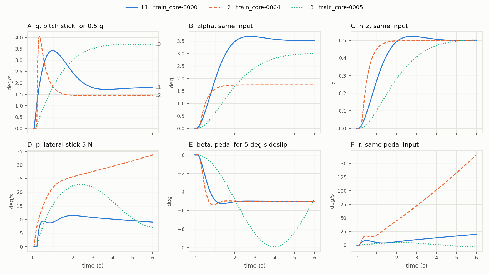
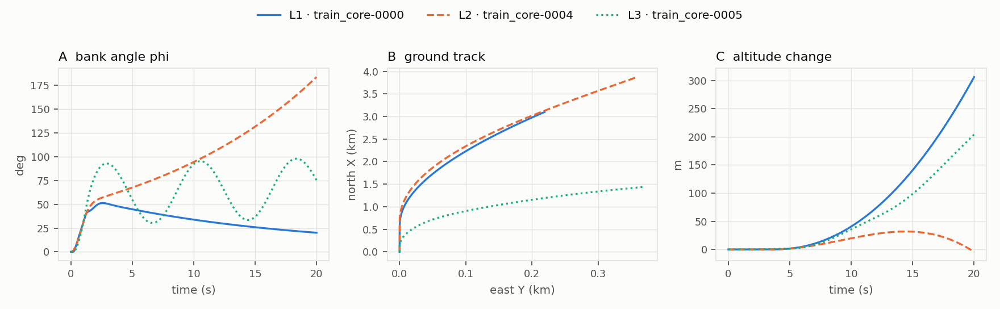

# 六通道品模：传递函数 → 动力学 → 运动学 · 2026-10-29

按 `品模构建.xmind` 的“六自由度飞机”分支实现第一版多通道品模，范围为短周期。原交付包、`FQControl_Model`、`ppo_fixes_2026-10-26` 和 5,000 对象滚转库均未修改；本目录没有训练任何模型，也没有占用 GPU。

```
杆力输入 Fs（俯仰，拉为正）、Fas（横向，右为正）、Frp（脚蹬，右为正），单位 N
   │  品模：短周期低阶等效传递函数，参数由飞行品质采样
   ▼
动力学输出 V, α, q, β, p, r（另给出 n_z、γ）
   │  运动学：稳定轴 p、r 经 α 转到机体轴，旋转矩阵逐步精确传播，读出欧拉角；机体速度转到地面系积分位置
   ▼
x = [V, α, q, θ, β, p, r, φ, ψ, X, Y, Z]（xmind 的状态顺序）
   另加：组合轴惯性耦合 q̇ += (Iz−Ix)/Iy·pr + Ixz/Iy·(r²−p²)
```

## 六个通道

| 通道 | 实现 | 来源 |
|---|---|---|
| q | q/Fs = Kθ(s+1/Tθ2)e^(−τθ s)/(s²+2ζsp ωsp s+ωsp²) | GJB A5.1.1.1（PDF 76，印刷 72）。扫描页写作 θ̇/Fs，正文为“俯仰速率”；xmind 截图丢了 θ 上的点，按 θ=q/s 使用 |
| α | α/Fs = Kθ e^(−τθ s)/(同一分母)，即 xmind 的 θ/Fs·Tθ2 s/(Tθ2 s+1) | xmind；γ/θ = 1/(Tθ2 s+1) |
| n_z | n_z/Fs = Kθ·(n/α) e^(−τθ s)/(同一分母) | GJB PDF 77；Knz 由 Kθ 和 n/α = V0/(g·Tθ2) 推出，不单独采样 |
| V | V = V0 | 短周期假设速度不变；xmind 长周期节点为空，输入也没有油门 |
| p | 原 single-s P 通道，直接调用冻结的 `PChannel` | 与 `FQControl_Model` 源文件哈希一致；随机输入下逐点相等 |
| β | β/Frp = −k_rp e^(−τrp s)/(s²+2ζd ωd s+ωd²) | xmind；ζd、ωd 取自该对象的滚转参数 |
| r | r/Frp = k_rp(s²+2ζr ωr s+ωr²) e^(−τrp s)/((s−λs)(s²+2ζd ωd s+ωd²)) | xmind 的 r/δr·δr/Frp；λs、ζd、ωd 共用滚转参数 |

纵向用物理状态 [α, q] 实现：α̇ = −α/Tθ2 + q，q̇ = Mα α + Mq q + Kθ Fs + c_q，其中 Mq = 1/Tθ2 − 2ζsp ωsp，Mα = −ωsp² − Mq/Tθ2。它与上表 q、α、n_z 三个传递函数完全等价，惯性耦合项 c_q 由此进入俯仰角加速度。

β 与 r 由同一偏航力矩驱动，取 K_β = −A_r G_r = −k_rp。用 Nelson 教材 Navion 横航向导数核对：β/δr 高频增益 4.6 与 −Nδr = 4.597 相符；r/δr 的实零点 −8.64 与滚转模态 −8.43 近乎对消，支持 xmind 的三阶形式。两个脚蹬通道共用一个传输延迟，因为输入路径相同；xmind 只在 β 式写了延迟。

## 对象库

`library/joint_six_channel_5000_v1/` 在原 5,000 个滚转对象上逐个补充纵向、脚蹬和惯性参数。滚转参数、划分和 IV-A 分项等级逐字保留。纵向等级不超过滚转等级，因此按最差项的联合等级与原配额一致：1/2/3 级各 1,500，OOD 500。纵向四项中一项按轮换推到目标等级，其余在 1 级到目标等级间抽取；全部 5,000 个对象复评等级与设计一致。

| 参数 | 取值 | 依据 |
|---|---|---|
| ωsp 与 CAP=ωsp²/(n/α) | 1 级 0.28–3.6 且 ωsp≥1.0；2 级 0.16–10 且 ωsp≥0.6 | GJB 图 A3(a)，A 种阶段，PDF 78 |
| ζsp | 1 级 0.35–1.30；2 级 0.25–2.00；3 级取 0.10–0.25 或 2.0–2.6 | 表 A6，PDF 77 |
| τθ | 1/2/3 级上限 0.10/0.20/0.30 s | 表 A7，PDF 80 |
| Fs/n | 中央杆，n_L=7：1 级 16.7 至 clip(1090/(n/α), 41.7, 125) N/g，2、3 级按表 | 表 A10(a)，PDF 154 |
| V0、1/Tθ2 | 60–250 m/s、0.4–2.5 1/s，对应 n/α 2.5–62 g/rad | 研究包络，落在图 A3 的 1–100 范围内 |
| 侧滑梯度 | 0.02–0.2 °/N（10° 侧滑需 50–500 N） | 研究包络，无 GJB 分级 |
| ωr/ωd、ζr | 0.1–0.5、0.05–0.6 | 研究包络，只用 Navion（0.22、0.14）一个机型锚定，最需要文献数据补强 |
| τrp | 0.001–0.2 s | 与滚转 τp 的同分布范围一致 |
| (Iz−Ix)/Iy、Ixz/Iy | 0.8–1.0、0–0.05 | Navion、F-16、B747 惯量比所在范围 |

实际 ωsp 为 0.48–27 rad/s。上端来自 3 级高 CAP 分支（CAP 至 20）与 n/α≈60 的组合，规范允许但动态偏激烈。

## 验证

14 项 CPU 测试全部通过，见 `tests/`；`verify.py` 写出 `verification.json` 和两幅图。

- 延迟取整到 1 ms 网格时，六个输出与对应连续传递函数阶跃响应的相对误差均低于 1e-6。
- 库内实际延迟不在网格上，沿用滚转通道的线性插值分数延迟。相对精确连续纯延迟，40 个对象（四个分桶各 10 个）的误差中位数为 1e-7 至 4e-6，最大 2.2e-4（q 通道）。
- γ 经一阶滞后跟随 θ（误差 <0.5%）。CAP 等于初始俯仰角加速度除以稳态 n_z（误差 <0.5%）。稳态 n_z·(Fs/n) = 1。
- 关闭惯性耦合时三路输入互不影响。打开后 q 的响应与用记录 p、r 独立积分的结果相差 <0.2%。
- 旋转矩阵读出的欧拉角满足 xmind 的 θ̇ = q cosφ − r sinφ 等三式（1e-6）。等 α 绕稳定轴滚转时，航迹侧偏小于前进距离的 1e-9。



三个代表对象各通道的阶跃响应。俯仰杆力按 0.5 g 给定；脚蹬力按 5° 稳态侧滑给定。2 级对象的螺旋根为正（λs=+0.067，允许的倍幅时间 ≥8 s），所以 p 和 r 在开环下持续增长；3 级对象的荷兰滚阻尼仅 0.005。



横向杆在 1 s 内压到约 30° 坡度后松杆，3 s 起拉 0.3 g：1 级对象爬升转弯；2 级对象螺旋发散超过 90° 后在拉杆下掉高度；3 级对象的坡度随荷兰滚振荡。

## 尚未包含

- 长周期（沉浮、V 通道）与油门输入；直接法向力输入。
- 交叉通道：β/Fas、p/Frp 等为零。滚转与侧滑之间只经运动学和惯性耦合相连，不含重力项与上反效应，所以只踩舵不会带来坡度。
- 纵向无大迎角或速度变化，Dryden 湍流未接入。
- 脚蹬通道没有 GJB 分级，荷兰滚等级沿用滚转库 A35。
- 尚无批量 GPU 环境、奖励与指令设计；下一步按 xmind 在三条控制回路上分别训练教师。

## 模型规模估算

`estimate_size.py` 用现有网络代码计数。先复现滚转 tiny 学生 3,856、教师 Actor 4,255,537 参数，再按三条控制回路扩展观测（每回路沿用滚转回路的信号，另加 α、n_z、φ、θ 四个共享量），观测由 176 维增至 660 维。

| 统一学生结构 | 参数量 |
|---|---:|
| tiny 同构（卷积 8，32×1） | 5,408 |
| 加宽（卷积 16，64×2） | 25,152 |
| small 同构（卷积 24，256×4） | 560,416 |
| 教师同构（卷积 24，512×8） | 4,269,856 |

教师按每对象每回路一个，Actor 仍为 4,255,537 参数。按 GPU 4 实测的每教师 142.8 卡秒外推：3,000 个对象需 9,000 个教师，约 357 卡时，五卡约 71 小时；5,000 个对象约 595 卡时、五卡约 119 小时。三回路教师的实际训练难度和时间尚未测量。

## 运行

```bash
cd /home/swj/pingmo/six_channel_model_2026-10-29
PYTHONDONTWRITEBYTECODE=1 python -m unittest discover -s tests -v
PYTHONDONTWRITEBYTECODE=1 python verify.py
PYTHONDONTWRITEBYTECODE=1 python estimate_size.py
```

对象库由 `pinmo6.sampler.build_joint_library` 生成（种子 20261029），已存在时拒绝覆盖。

## 第二版：交叉通道、长周期与湍流（2026-10-30）

按用户要求，查阅文献设计交叉通道，并处理上面“尚未包含”中的限制。设计、依据、结果和待决事项见 [交叉通道与其余限制_设计说明.md](交叉通道与其余限制_设计说明.md)。v1 的类、对象库和图保持不变。

| 新增文件 | 内容 |
|---|---|
| `pinmo6/derivatives.py` | 横航向与纵向四状态导数的闭式反解：保持冻结 p/Fas 和 GJB 短周期完全不变 |
| `pinmo6/coupled.py` | 耦合模型：线性气动、风轴重力与运动学、完整惯性耦合、油门与直接法向力、阵风输入 |
| `pinmo6/turbulence.py` | MIL-STD-1797A Dryden 湍流成形滤波器与中高空、低空参数 |
| `pinmo6/criteria.py` | 荷兰滚 φ/β 修正、滚转振荡、侧滑偏离、定常侧滑方向、长周期（MIL 与 GJB 页码对照） |
| `pinmo6/plausibility.py`、`pinmo6/library_v2.py` | 按 CR-2144 真实飞机范围选择导数，生成 v2 库 |
| `literature/` | 三份公开文献原件、四份阅读笔记、CR-2144 数据表、`envelopes.json`、GJB 页面截图 |
| `library/coupled_six_channel_5000_v2/` | 5,000 个对象的耦合导数、交叉轴等级、长周期 |
| `verify_v2.py`、`verification_v2.json`、`figures/*_v2.*` | 统计与图 |

主要结果：

- 横航向在保持原 p/Fas 不变时只剩 Yβ、L′r 两个自由量，其余导数有唯一闭式解。交叉通道因此大部分已由现有滚转库决定。
- 47% 的对象能找到落在 CR-2144 真实飞机范围内的导数。
- 新增的交叉轴判据（主要是侧滑偏离）使原滚转 1 级对象中 61% 降为 3 级。综合各通道后，原 1 级仍为 1 级的只有 9%。
- 13% 的对象长周期在 55 s 内倍幅，主要来自 ζsp 过阻尼。

是否改为“导数优先”的横航向联合采样，需要你决定。

```bash
PYTHONDONTWRITEBYTECODE=1 python -m unittest discover -s tests -v   # 29 项
PYTHONDONTWRITEBYTECODE=1 python build_v2.py                        # 约 10 分钟，已存在时拒绝覆盖
PYTHONDONTWRITEBYTECODE=1 python verify_v2.py
```

## 第三版：重新采样的对象库（2026-10-30）

按用户确认，采用“模态按 GJB 等级采样、耦合形状取自真实飞机、导数精确解出、全部判据综合分级”的方式重新生成 `library/six_channel_5000_v3/`：1/2/3 级各 1,500，OOD 500，划分与原库相同。每级内部按定级来源轮流选取。

- 每个对象都能对应一架真实飞机：导数落在 CR-2144 的 94 个真实状态范围内。
- 滚转零点由物理推导得出，与真实飞机分布一致。
- 全部交叉轴判据和长周期参与定级。

细节见设计说明第 6 节。

| 新增文件 | 内容 |
|---|---|
| `pinmo6/sampler_v3.py` | 候选生成、并行评级、分层选取；`load_v3` 直接给出可仿真的耦合飞机 |
| `pinmo6/derivatives.py` 中的 `lateral_from_modes` | 由四个横航向极点与形状比解出导数（四次方程） |
| `build_v3.py`、`verify_v3.py`、`verification_v3.json`、`tests/test_v3.py` | 生成、统计与检查 |

```bash
PYTHONDONTWRITEBYTECODE=1 python build_v3.py     # 32 个 CPU 进程约 1 分钟，已存在时拒绝覆盖
PYTHONDONTWRITEBYTECODE=1 python verify_v3.py
PYTHONDONTWRITEBYTECODE=1 python -m unittest discover -s tests   # 35 项
```

## 第四版：合理性检查后的对象库（2026-10-31）

合理性检查（设计说明第 7 节）发现 v3 有几处定级与真实性问题，按用户确认重新生成 `library/six_channel_5000_v4/`。构造方式与 v3 相同，配额与划分不变；v3 保留不动。

- 滚转等效延迟按 GJB 表 A21 定级，并按各级采样。
- 标准对各级都要求的项不满足时归入 OOD：定常侧滑方向、表 A4 的 1/T_θ1 > 0、长周期非周期发散。
- 要求 N′r < 0、M_q < 0。
- L′r/N′r 按真实分位数抽取。
- 配平迎角取 1/(n/α) 加零升偏差，I_xz 按惯性主轴倾角给出（新增量见 `literature/envelopes_v4.json`）。
- 同时修正了全量模型的稳定轴转动项（`pinmo6/coupled.py`），并新增角动量守恒测试。

细节见设计说明第 8 节；观察页已切换到 v4。

| 新增文件 | 内容 |
|---|---|
| `pinmo6/sampler_v4.py` | v4 的候选生成、评级与选取；`load_v4` 给出可仿真的耦合飞机 |
| `literature/envelopes_v4.json` | v3 范围加三项真实数据：L′r/N′r 分位数、主轴倾角、配平迎角偏差 |
| `build_v4.py`、`verify_v4.py`、`verification_v4.json`、`tests/test_v4.py` | 生成、统计与检查 |

```bash
PYTHONDONTWRITEBYTECODE=1 python build_v4.py     # 32 个 CPU 进程约 1 分钟，已存在时拒绝覆盖
PYTHONDONTWRITEBYTECODE=1 python verify_v4.py
PYTHONDONTWRITEBYTECODE=1 python -m unittest discover -s tests   # 45 项
```
